# Learn English with Manga

[](https://github.com/Mrch1io/learn-english-with-manga/actions/workflows/tests.yml)

Local, offline Japanese-to-English manga translation: detection → OCR → translation → text removal and typesetting → click a bubble to hear the original Japanese. Runs on a single 8GB laptop GPU.

https://github.com/user-attachments/assets/e3a6ee3b-f573-4f81-a2d9-1f7ccafbee96

[View video file](demo-video/demo-30s-hq-en.mp4)

[Courses I studied on my own, and where they show up](#what-i-learned-for-this-project)

[](USAGE_EN.md#installation)
[](#data-layer-sqlite)
[](USAGE_EN.md#installation)
[](ui/app.py)

[](vision/graphics.py)
[](translation/vntl.py)
[](vision/detection.py)
[](vision/detection.py)

**Language / 语言**: English | [简体中文](README_CN.md)

## Why I Built This

As a longtime anime and manga fan teaching myself Japanese, and needing to get through a dreaded English exam, I started wondering: why couldn't I improve my English while reading manga? That's how this project came about. Since I'm fairly cost-conscious, my first choice was to deploy a local large language model to handle the translation.

Only after I actually tested the first prototype did I realize that the problem wasn't just getting a translation out. There were also questions like these: What if one sentence is split across two bubbles? What if the same name is translated one way at first and another way later? What if the English reads smoothly but gets "who did what to whom" backwards? Most of these problems have since been solved, and the ones that remain unsolved have become directions for future research.

## Showcase

| Original Japanese image | Exported English image |
| --- | --- |
| 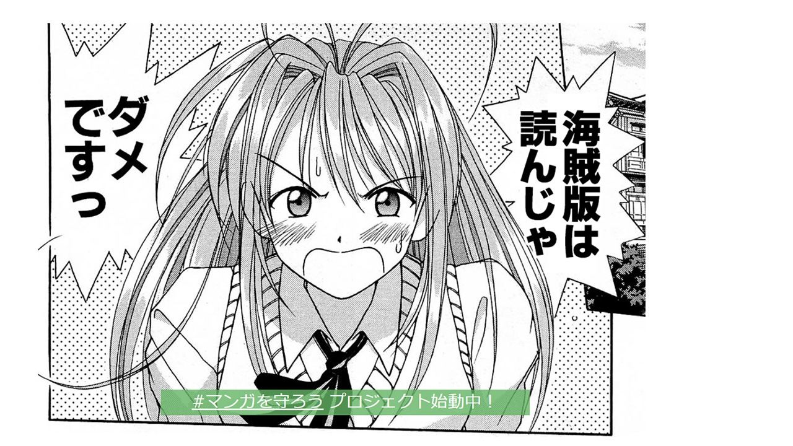 | 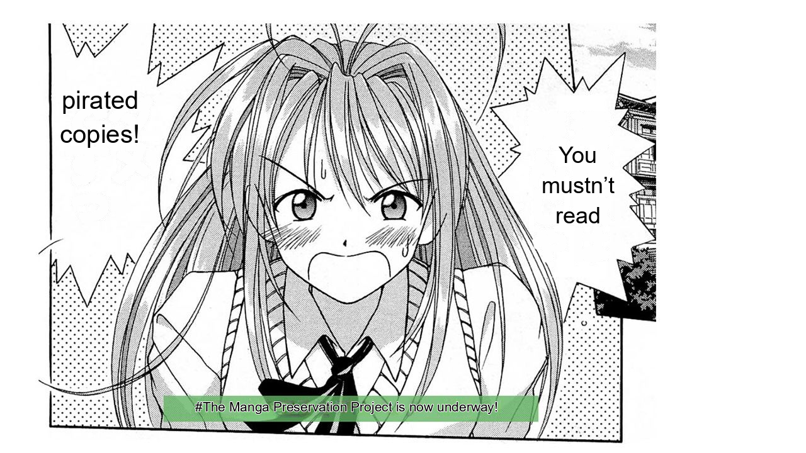 |

<sub>VNTL translation result: a sentence that spans two bubbles is translated as one whole sentence, then distributed back into the original boxes.</sub>

| Original full page | VNTL automatic output (no manual edits) |
| --- | --- |
| 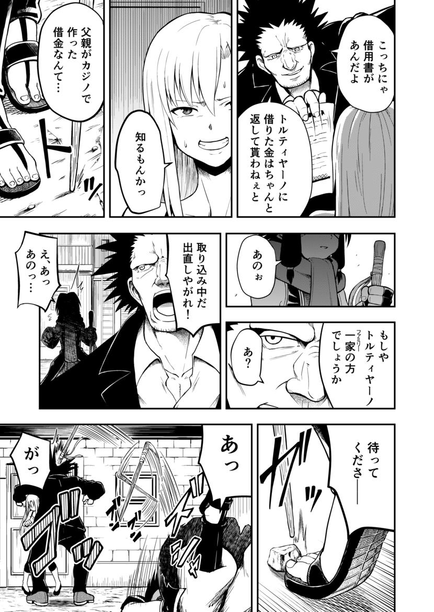 | 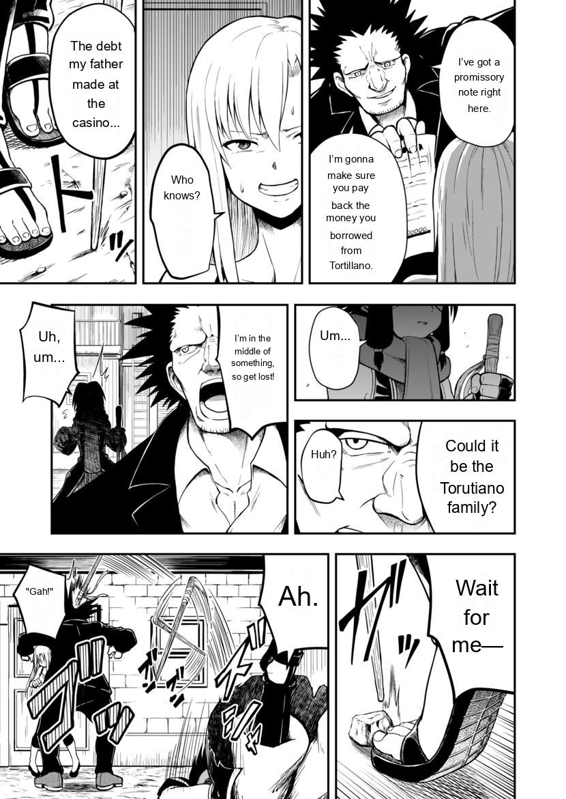 |

<sub>Page 3 of tojime_no_siora, an OpenMantra test work. Output: Manga-OCR recognition, VNTL translation, automatic text removal and typesetting. The image also shows an unsolved problem: the same family name is first translated as `Tortillano` and later as `Torutiano`, which is also why names are later locked with a glossary.</sub>

## App Interface

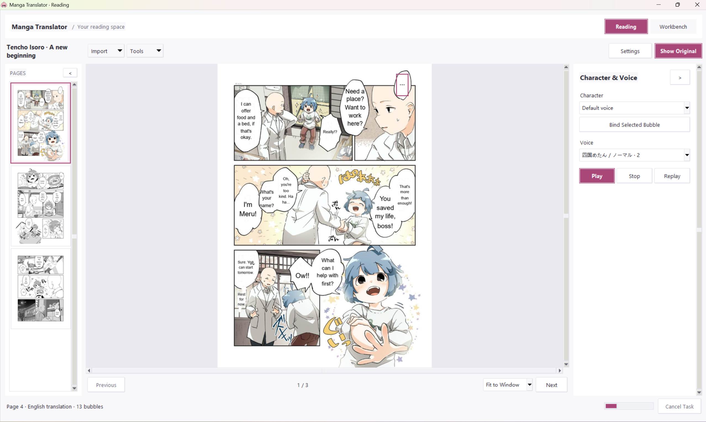

| Task window | Settings |
| --- | --- |
| 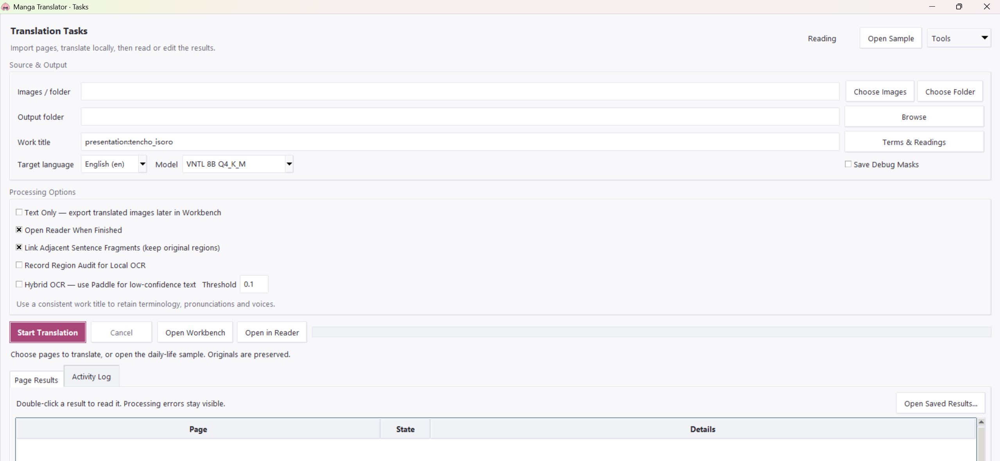 | 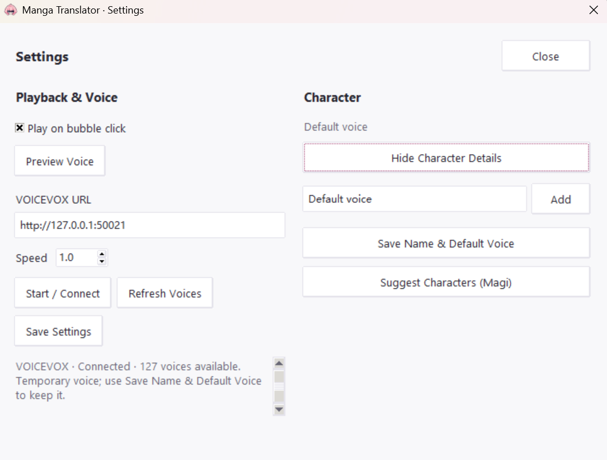 |


## ✨ Core Features

### Translation and Terminology Management

- 🔍 **Manga text detection** - Combines YOLO bubble detection with supplementary full-page text detection from Magi to find dialogue, narration and text outside bubbles
- 📝 **Japanese OCR** - Uses Manga-OCR to recognize Japanese manga text, with optional PaddleOCR-VL to supplement low-confidence results
- 💻 **Local Japanese-to-English translation** - Uses the VNTL model by default; runs offline once the models are set up (API support coming later)
- 💬 **Context-assisted translation** - Gives the model nearby dialogue, relevant terms and manually confirmed character information to help it understand the current bubble
- 🔗 **Cross-bubble linked translation** - Links some split sentences based on reading order, position and text rules, translates each as a whole sentence, then distributes the English back into the original bubbles
- 📚 **Per-work glossary** - Stores personal names, proper nouns, aliases and Japanese readings in SQLite.

### Manga Reading and Japanese Click-to-Listen

- 📖 **Batch translation** - Import a folder to browse its pages in natural order, and switch between the original Japanese images and the English translations
- 🔊 **Click a bubble to hear the Japanese** - Integrates VOICEVOX: click a bubble and its Japanese is read aloud
- 🎭 **Character and voice management** - Binds dialogue and a default voice to each character, saved per work and reused across pages
- 👤 **Character association suggestions** - Optionally uses Magi to suggest associations between characters and dialogue

### Text Removal, Typesetting and Proofreading

- 🧹 **Source text removal and background restoration** - Processes the original text according to the text mask, restores the background by combining solid-color fill with LaMa, and protects prominent borders and lines
- 🎈 **Automatic English typesetting** - Measures text width and height against each bubble's usable area, wrapping lines and adjusting the font size automatically
- ✏️ **Proofreading** - Supports manual review of the OCR source text and the English translation, plus side-by-side comparison of local regions of the original and translated images, with local updates

### Batch Processing and Local Execution

- 📦 **Folder batch translation** - Handles multiple images and subfolders, records each page's status, and keeps processing the remaining pages when a single page fails
- ⚡ **Read first, export later** - Save the recognized and translated text first for click-to-listen reading, then generate translated images when needed, without repeating detection, OCR or translation

## Architecture

```mermaid
%%{init: {"theme": "base", "themeVariables": {"fontFamily": "Inter, Segoe UI, Arial, sans-serif", "fontSize": "14px", "lineColor": "#94A3B8", "primaryTextColor": "#1E293B"}, "flowchart": {"curve": "basis", "nodeSpacing": 32, "rankSpacing": 40, "padding": 16}}}%%
flowchart LR
    IN["CLI / GUI / Folder Batch"] --> PIPE["pipeline.process_page<br/>Three entry points · one pipeline"]
    PIPE --> DET["Detection<br/>YOLO + Magi"]
    DET --> OCR["Japanese OCR<br/>Manga-OCR"]
    OCR --> TR["Translation<br/>VNTL 8B · llama.cpp"]
    TR --> LAY["Layout Preflight<br/>Pillow"]
    LAY --> INP["Text Removal<br/>LaMa"]
    INP --> REN["Render English Text"]
    REN --> OUT[("Translated PNG + Page JSON<br/>Per-file atomic writes · hash check")]
    DB[("SQLite<br/>Terms / Aliases / Characters")] <--> TR
    POOL["ModelPool<br/>GPU Memory Scheduling"] -.-> DET
    POOL -.-> OCR
    POOL -.-> INP
    OUT --> READ["Reader<br/>Click-to-Listen · VOICEVOX"]
    OUT --> EDIT["Proofreader<br/>English: reflow only<br/>Japanese: retranslate, update the edited bubble only"]
    EDIT --> OUT

    classDef entry fill:#0F172A,stroke:#0F172A,color:#FFFFFF,stroke-width:1.5px,rx:12,ry:12;
    classDef process fill:#EEF2FF,stroke:#A5B4FC,color:#312E81,stroke-width:1.5px,rx:10,ry:10;
    classDef graphics fill:#F0FDFA,stroke:#5EEAD4,color:#115E59,stroke-width:1.5px,rx:10,ry:10;
    classDef storage fill:#FFFBEB,stroke:#FCD34D,color:#78350F,stroke-width:1.5px;
    classDef support fill:#F8FAFC,stroke:#CBD5E1,color:#475569,stroke-width:1.5px,rx:10,ry:10;
    classDef application fill:#EFF6FF,stroke:#93C5FD,color:#1E3A8A,stroke-width:1.5px,rx:10,ry:10;

    class IN,PIPE entry;
    class DET,OCR,TR process;
    class LAY,INP,REN graphics;
    class OUT,DB storage;
    class POOL support;
    class READ,EDIT application;
    linkStyle default stroke:#94A3B8,stroke-width:1.5px;
```


## My Early Work: Training a YOLO Bubble Detection Model

Early in the project, I trained a manga bubble detection model (`Bubble with Text`) on top of YOLOv8m pretrained weights, and the resulting `best.pt` is still used for single-image and batch translation. It first draws boxes around bubbles that contain text, then crops them and hands them to Manga-OCR, so a missed detection or an offset box directly affects recognition; Magi is now also used to supplement text-region detection. All training goes through [tools/train.py](tools/train.py), where you can specify the dataset, initial weights and number of epochs; using the existing `best.pt` as the initial weights fine-tunes it. See the [training instructions](USAGE_EN.md#training-the-bubble-detector) for the commands. The weights are loaded by [`detect()`](vision/detection.py).

## What I Built

Starting from this detection model, I built the complete pipeline from translation to reading:

- **Shared processing pipeline** [pipeline/batch.py](pipeline/batch.py): batch processing, natural sorting, per-page error isolation, cancellation, result caching and per-file atomic writes with hash checks.
- **Local translation backend** [translation/vntl.py](translation/vntl.py): integrates VNTL Llama3 8B (GGUF Q4_K_M), with inference served by a local llama.cpp server that the task starts itself, and output constrained by a GBNF grammar.
- **Terminology and character data layer** [core/memory.py](core/memory.py): 8 SQLite tables, all isolated by work; terms and translation jobs are also isolated by target language.
- **Reading, proofreading and click-to-listen** [reader/window.py](reader/window.py) · [pipeline/editing.py](pipeline/editing.py) · [ui/app.py](ui/app.py) · [audio/speech.py](audio/speech.py).
- **Evaluation practice**: freezing, scoring, bootstrap and blind-review material generation
- **Offline regression tests** [tests/](tests/): models, CUDA, HTTP and speech all use test doubles; no weights are loaded and no paid APIs are called

### What I Learned for This Project
Neither when I first started this project nor later when I was optimizing it had I received any systematic computer science education, and this has always been a regret of mine. On this self-taught path, I'm especially grateful to the teachers at my school who looked out for me, to people online, and to AI. AI helped me a lot, much like a teacher: whether by recommending relevant courses or by suggesting solutions to specific problems. The difficulties below are ones I came to understand bit by bit through all kinds of self-study, and each one is recorded as "Problem → Approach → Verification → What I learned".

Here is where each course ended up; the links jump straight to the matching section:

| Course I studied on my own | What I learned → where it's used |
| --- | --- |
| CS50x | Binary search → [font-size search in at most 6 tries](#6-remove-text-without-damaging-line-art-typeset-without-truncating); transactions → [saving three files together without destroying existing proofreading](#3-a-sudden-crash-mid-save-must-not-destroy-manually-proofread-files) |
| Python for Everybody | Caching results in SQLite → [deciding when a cached page is stale](#4-changing-one-word-shouldnt-rerun-the-whole-page-changing-the-translated-english-name-haru-to-haruya); foreign keys → [the glossary data layer](#data-layer-sqlite) |
| Algorithms | TSP state compression → [locked-name grammar states grow with 2ⁿ instead of n!](#2-the-names-were-locked-so-why-did-the-model-still-change-translations-and-alter-ids); complexity analysis → [compare only adjacent bubbles](#5-one-sentence-split-across-two-bubbles) |
| UW Machine Learning | Use the test set only once → [confirm on an unseen work](#3-can-likely-mistranslated-bubbles-be-flagged-in-advance); favor precision when false positives are costly → [when in doubt, don't merge](#5-one-sentence-split-across-two-bubbles) |
| CS224N | Limits of overlap metrics → [chrF++ as a reference only, plus human review](#1-which-local-model-should-i-use) |
| CS336 | Resource accounting → [fitting the models into 8GB of VRAM](#1-8gb-of-vram-cant-fit-all-the-models-cuda-out-of-memory-halfway-through-a-run); constrained decoding → [fix the input, let the grammar catch the rest](#2-the-names-were-locked-so-why-did-the-model-still-change-translations-and-alter-ids); BPE → [removing an intra-word comma](#5-one-sentence-split-across-two-bubbles) |

## Problems I Ran Into

### 1. 8GB of VRAM can't fit all the models: CUDA out of memory halfway through a run

- **Approach**:
  - The VNTL 8B translation model is quantized to Q4_K_M (about 4.9GB) and stays resident on the GPU through llama.cpp.
  - The detection, OCR and text-removal models take turns on the GPU stage by stage via [`ModelPool`](core/runtime.py); weights not currently in use stay in RAM, and each model is loaded only once per batch job. Before entering each stage, it first checks whether the free VRAM is enough for that stage's budget; if not, it shuts down the translation server first and starts it again when needed.
  - When VRAM runs out, it first moves all the other models back to RAM, then retries the current stage once; it never reruns indefinitely. On errors, it also clears the exception stack so that tensors left behind by the failure don't keep holding VRAM.
  - Before moving the Qwen2.5-3B comparison model back to RAM, it first checks how much memory Windows can still allocate (commit); if there isn't enough, it releases the model outright and reloads it on the next page.
  
- **Constraint**: Inference runs only on CUDA. Without a GPU, it raises an error right away instead of quietly falling back to the CPU.

<details>
<summary>Verification</summary>

- **Verification**: [tests/test_models.py](tests/test_models.py) asserts four things: weights are loaded only once; when free VRAM is below a stage's budget, the translation server is shut down first; out-of-memory errors are retried only once; when RAM is insufficient, the model is released instead of copied; and without CUDA, it raises an error right away.

</details>

> [!TIP]
> **What I learned**:
> - Do the resource math before getting started: counting the weights alone, an 8B model in fp16 needs about 16GB (8 billion × 2 bytes), which an 8GB card can't hold; only after quantizing to Q4_K_M, at about 4.9GB, is there room left for the KV cache and the other models. Before offloading the Qwen model, the code likewise first tallies the tensors' actual size in bytes, then decides whether to copy it back to RAM or release it outright ([`ModelPool.offload()`](core/runtime.py)).
> - A model moves between the CPU and GPU as a whole copy (`.to(device)`), so moving it back to RAM also requires freeing up room for a whole copy there.
> - `torch.cuda.empty_cache()` only returns idle cached VRAM to the driver; tensors that are still referenced are not freed by it.
> - An exception's traceback references the stack frames from where the error occurred, so the intermediate tensors in those frames can't be freed.
> - On Windows, allocatable memory (commit) and free memory are not the same thing: even when there seems to be RAM to spare, allocation still fails if commit runs short.
> - Ultimately, VRAM problems have two layers: first, get the accounting right to see whether the models fit together; then, look at who still holds references and when they are released. Resources need a clear lifecycle; I can't count on garbage collection to clean up after me.
>
> **Applied knowledge**: The resource accounting part of CS336; the memory management section of CUDA semantics in the PyTorch documentation; printing the free VRAM with `torch.cuda.mem_get_info()` before and after each step and comparing the results experimentally.

### 2. The names were locked, so why did the model still change translations and alter IDs?

- **Problem**: The glossary locks both 「美咲」 and the nickname 「みーちゃん」 to `Misaki Takanashi`. Before the fix, VNTL translated 「みーちゃん、その鍵はどこ？」 as `Mii-chan, where's that key?` and 「美咲、先に白銀門へ行って。」 as `Misaki, go ahead to Silver Gate.`, neither of which used the locked full name. The name also has to appear in the bubble that contains the corresponding Japanese; appearing once in the neighboring bubble doesn't count. There was an even earlier problem: unconstrained VNTL used to change bubble IDs to uppercase, rewrite longer IDs, and even change the IDs of different bubbles all into the character name `Kenta`. Once the IDs are scrambled, the translations can't be matched back to their bubbles, and they can't be assigned by guessing from position either.

- **Approach**: Three layers.
  - Input: First, a [pre-check (`validate_input()`)](translation/vntl.py): input that contains the model's reserved control tokens (`<|`, `|>`), more than 4 locked names, or locked names totaling more than 256 characters is stopped before the model is loaded or anything is tokenized, while the other bubbles in the same group are translated as usual. Then, [by exact span (`_locked_source()`)](translation/vntl.py), locked source names and aliases are replaced with their locked English spellings; the saved OCR, Japanese click-to-listen and the page's source text all remain in Japanese. When the same stretch of Japanese maps to two different translated names, this step also reports the ambiguity and asks the user to fix the glossary first.
  - Decoding: Generation is constrained with llama.cpp's [GBNF grammar (`label_grammar()`)](translation/vntl.py). The grammar fixes the bubble IDs and their order, so the model can only generate the English after each ID. Each bubble gets its own line, and that line must contain every locked name matched in its own source text, in any order, with a Latin word boundary on both sides of each name.
  - Output: After generation finishes, the result is checked once more; if it doesn't meet the requirements, it fails explicitly and keeps the source text, with no replacements made to the generated English.

  The [grammar states (`_locked_line_grammar()`)](translation/vntl.py) use a bitmask to record "which locked names have already appeared," plus one bit recording whether the end of the previous name requires a word boundary; identical states reuse the same rule. With four names, recording the order would take 65 prefix states, while recording only the set takes just 2⁴ = 16, or at most 32 with the word-boundary flag. Ordinary words are unconstrained, so English word order remains free.
  
<details>
<summary>Verification</summary>

- **Verification**:
  - Real model: At first, with only the grammar constraint and no input normalization, 4 results failed because they hit the token limit with incomplete output. After input normalization was added, the two sentences were translated as `Misaki Takanashi, where is that key?` and `Misaki Takanashi, go to Silver Gate first.` ([follow-up record](evidence/validation/VNTL_EN.md)).
  - Grammar tests: [tests/test_vntl_locked_terms.py](tests/test_vntl_locked_terms.py) checks that the full name must appear in its own bubble, so writing only `Misaki` or putting it in the neighboring bubble fails; that `Hannah` and `Annie` can't pass for `Ann`; that four names pass in any order but fail if one is missing, with no more than 32 rules; and that ambiguous, overlong or malformed locked terms raise explicit errors.
  - Pre-check tests: [tests/test_translation_input_validation.py](tests/test_translation_input_validation.py) checks that bad input is rejected before the model is loaded, the prompt is built or anything is tokenized; that one bad bubble in a group doesn't drag down the good bubbles next to it; and that when connecting directly to the server, the grammar is validated before any HTTP request is sent.
  - llama.cpp's native grammar sampler: All 14 accept/reject decisions matched expectations ([record](evidence/validation/vntl-grammar.json)), loading only the vocabulary, not the inference weights.

</details>

> [!TIP]
> **What I learned**:
> - Decoding constraints can only rule things out; they can't make the model "think of" something. The grammar says this line can't end before the full name is written, but what the model reads is still 「みーちゃん」, so it almost never writes the full name on its own and can only keep writing within the allowed range until it hits the token limit. Change the input to the full name first, and the model writes it by itself; the grammar only serves as a safety net.
> - By recording only "which ones have appeared" and not the order, the number of states grows with 2ⁿ instead of n!; then capping the number of locked names guarantees a bound on the grammar's size.
> - Errors that can be caught at a cheap stage shouldn't be left to an expensive one: checking control tokens and locked names is just string manipulation, whereas loading the model and running a round of generation costs much more, and a failure means starting over.
> - Requirements in a prompt should be turned into conditions that a program can check. But meeting both the spelling and position requirements doesn't mean the meaning is correct: other sentences in the report still have translations that need manual correction.
>
> **Applied knowledge**:
> - In CS336's coverage of inference, at each step the model computes a score (logit) for every token in the vocabulary, converts the scores into probabilities, and picks the next token. Before that pick, llama.cpp's grammar constraint sets the scores of tokens that would violate the grammar to negative infinity, so their probability becomes 0, while the relative scores of the remaining tokens stay the same. In this project, generation uses [temperature 0 (`VntlServer.generate()`)](translation/vntl.py), so each step picks the highest-scoring token among those remaining. So the constraint changes "what can be chosen," not what the model "wants to choose."
> - When the Algorithms course covered the traveling salesman problem, brute-force enumeration had to try n! routes; dynamic programming defines the state as "the set of cities already visited + the current city," computes each state only once, and brings the work down to O(n²·2ⁿ). I borrowed this idea when designing the grammar states for locked names: a state is "the set of names that have already appeared + one word-boundary bit," the set is represented with binary bits, writing each new name sets its corresponding bit to 1, and identical states reuse the same grammar rule.


### 3. A sudden crash mid-save must not destroy manually proofread files

- **Problem**: Each time batch translation finishes a page, and each time a change is saved in the proofreader, the program has to update three files together: the cleaned base image, the translated image, and the JSON that records each bubble's source text, translation and manual revisions. If something goes wrong partway through saving, you can end up with "the image is already new, but the JSON is still old," or a file that's only half written. Translation can be rerun, but losing manual proofreading is a real headache.

- **Approach**: [`_commit_files()`](pipeline/batch.py) commits in two steps: first, it writes each file to a temporary file in the same directory and `fsync`s it, while also backing up the old files; once everything is written, it replaces them one by one with `os.replace`, with the JSON last. If an ordinary disk-write error occurs during replacement, it restores the files one by one from the backups; if even the restore fails, it keeps the backups and states their location in the error message. But on a sudden exit, the rollback code never runs at all, and replacing multiple files can't be made atomic, so the JSON records each image's SHA-256, which is [checked (`PageEditorSession.__init__()`)](pipeline/editing.py) the next time it's opened; if an image doesn't match its record, editing is refused and nothing is overwritten.

<details>
<summary>Verification</summary>

- **Verification**: [tests/test_editing.py](tests/test_editing.py) simulates disk-write failures and checks that the translated image, the cleaned base image and the JSON roll back together; that nothing half-finished is committed on cancellation or translation failure; and that a translated image modified externally or a corrupted base image is rejected on both open and save. [tests/test_pipeline.py](tests/test_pipeline.py) makes each replacement of the three files fail in turn, and simulates a crash where "the image is written but the JSON isn't," confirming that this orphaned image is not overwritten after a restart.

</details>

> [!TIP]
> **What I learned**:
> - `write` returning doesn't mean the data has reached the disk; `fsync` is what asks the system to write it down. `os.replace` does only a single rename, so a reader sees either the old file or the new one, never a half-written one. The temporary file is created next to the target file because a rename can only be done within the same file system.
> - A single file can be "all or nothing," but multiple files together can't. When a full guarantee isn't possible, step back and make errors detectable: write the images first and the JSON last, so if the hashes in the old JSON don't match the new images, the next open reveals that this save didn't complete.
>
> **Applied knowledge**: CS50x's SQL lessons taught me that databases rely on transactions to guarantee that a group of changes either all take effect or none of them do. My three files have no database as a backstop, so I went to look up what the file system itself can guarantee.


### 4. Changing one word shouldn't rerun the whole page (changing the translated English name `Haru` to `Haruya`)

- **Problem**: A page goes through detection, OCR, translation, text removal and typesetting in turn. Take changing the character ハル's translated name from `Haru` to `Haruya`: if every change reran the whole page and the whole batch, changing one name would mean waiting for the entire book to be reprocessed; but if the cache makes the wrong call, an old result that still says `Haru` would be treated as the latest.

- **Approach**:
  - Changing `Haru` to `Haruya` in a bubble in the [proofreader (`PageEditorSession._edit()`)](pipeline/editing.py) counts as an English edit: OCR and translation don't run, and only that one bubble is re-typeset. Only editing the Japanese source triggers retranslation: a standalone bubble is retranslated by itself, while a bubble linked with its neighbor has the whole sentence retranslated. Either way, only the edited bubble's English is replaced; if the neighbor's English no longer matches the new translation, the editor asks you to check it.
  - When ハル's translated name is changed in the glossary and the batch is run again, a page is skipped only if every item recorded in its cache matches the current state: the input image's SHA-256, the [configuration fingerprint (`configuration_fingerprint()`)](pipeline/batch.py) (configuration, source code and model files), the terms actually matched in the page's source text, the page's confirmed speakers, and the hashes of the existing translated image and base image. So pages whose source text contains ハル are reprocessed, and all other pages are skipped. Pages that have already been manually proofread are not overwritten automatically; instead, they are marked "needs review," and the reader decides.
  - For the 5GB GGUF weights, only the path, size and modification time are compared; otherwise every text edit would first require reading through a 5GB file.

<details>
<summary>Example</summary>

- **Example**: [tests/test_pipeline.py](tests/test_pipeline.py) uses exactly this renaming scenario: after カナ's translated name is changed from `Kana` to `Kanna`, the pages that use it are reprocessed; adding an unrelated term (東京 → `Tokyo`) still skips them as usual. Changes to the input image, the configuration, newly added aliases and confirmed speakers likewise invalidate the cache; tentative identities and voice settings do not; computing the fingerprint doesn't read the GGUF weights; a translated image that was edited by hand is not treated as a valid cache; and pages with manual revisions stay as they are after the cache is invalidated, until `--force` is used explicitly.

</details>

> [!TIP]
> **What I learned**:
> - The hard part of caching isn't storing; it's deciding when something becomes invalid. Set the conditions too broadly and adding one unrelated term reruns the whole batch; set them too narrowly and an old page that still says `Haru` is treated as the latest. So tests have to cover both sides: what should be invalidated is, and what shouldn't be isn't.
> - Dependencies need to be as fine-grained as "what this page actually uses": a changed glossary doesn't mean every page is affected. Batch processing currently works at page granularity, so if ハル appears even once on a page, the whole page is reprocessed; the finer granularity of retranslating only the affected bubbles currently exists only in the proofreader.
> - Comparing only size and modification time is a deliberate trade-off: it misses cases where the content changed but neither the size nor the time did, and in return there's no need to read 5GB every time; the full SHA-256 is kept in the download records. A trade-off like this needs to be written down as a comment.
>
> **Applied knowledge**: The geocoding assignment (`geoload.py`) in the Python for Everybody databases course stores addresses it has already looked up, along with their results, in SQLite; on later runs it checks the database first and skips anything already found, so the program can pick up where it left off if it stops midway. But that cache only goes by the address, and once something is stored it's never updated. My results also depend on the configuration, terms and models, so there's one more problem to solve: when is a stored result no longer trustworthy?


### 5. One sentence split across two bubbles

- **Problem**: Manga often splits one sentence across two adjacent bubbles. For example, the first ends with 「読んじゃ」 and the second begins with 「ダメ」, and only together do they mean "don't read it." When each bubble is translated separately, neither half is a complete sentence, and the model can only guess.

- **Approach**: [`continuation_pairs()`](translation/vntl.py) compares only adjacent pairs of boxes in reading order, with O(n + number of characters) complexity, rather than enumerating every pair of boxes on the page. There are two grounds for merging: an explicit grammatical continuation (e.g., 「〜ちゃ」 + 「ダメ」 for a prohibition, 「〜ても」 + 「いい」 for permission), or short fragments that are adjacent, similar in font size, and whose first half is clearly unfinished. Failed OCR, confirmed different speakers, already finished sentences and closed quotation marks are never merged. The fragments found are translated as one whole sentence, then distributed back into their original boxes. If a word is split with a comma in between, such as 「はな、」 + 「せ…」, which together form 「はなせ…」 ("let go"), the [word-segmentation check (`normalize_word_boundary()`)](translation/vntl.py) removes that comma only when there is evidence of a word crossing the boundary, and it only changes the text sent to the model, leaving the OCR source untouched.

<details>
<summary>Verification</summary>

- **Verification**:
  - Rules: [tests/test_vntl_continuations.py](tests/test_vntl_continuations.py) and [tests/test_fragment_links.py](tests/test_fragment_links.py) check that complete sentences, quotations and unrelated dialogue are not merged; that boxes with different speakers or failed OCR stay separate; that a chain of three fragments isn't paired arbitrarily; and that once the whole-sentence translation is split back into the original boxes, each word appears only once. [tests/test_word_boundary.py](tests/test_word_boundary.py) checks that 「はな、」 + 「せ…」 has its comma removed; that 「はな、」 + 「そう…」 and 「あれ、」 + 「これ」 are left as they are, even though they also join into dictionary words; and that the comma is kept when 「はな」 is locked as a name.
  - Speed: A model-free microbenchmark on an i9-13980HX (median of 5 runs after warm-up):

    |   Test   |  20 boxes   |  200 boxes  | 2,000 boxes  |
    | :------: | :------: | :------: | :-------: |
    | Link-candidate scan time | 0.119 ms | 1.117 ms | 15.188 ms |

    Each 10× increase in the number of boxes increases the time by about 9–14×, close to linear; with pairwise comparison, it would be close to 100×. For 2,000 boxes plus the intra-word comma check, the first run takes 56.1 ms, and the median after warm-up is 18.1 ms ([scan record](evidence/validation/fragment-bench.json) · [intra-word comma record](evidence/validation/boundary-bench.json)). Run [tools/benchmark_fragments.py](tools/benchmark_fragments.py) to repeat the adjacent-fragment scan benchmark without models or CUDA.

</details>

> [!TIP]
> **What I learned**:
> - First think through the structure of the problem: in reading order, only adjacent boxes can continue each other, so there's no need to compare every pair of boxes.
> - Complexity can be checked by measurement: seeing how many times longer it takes when the input grows 10× is more reliable than just writing down O(n). 20 boxes take only 0.119 ms, which is negligible next to model inference; measuring up to 2,000 boxes was to confirm that it doesn't grow quadratically with size.
> - When in doubt, don't merge: a missed merge at worst gives a stiff translation, while a wrong merge mixes two people's lines into one sentence. The rules cover only common sentence patterns, and their boundaries need to be stated clearly.
> - A tokenizer first splits text at punctuation, and BPE merges don't cross that boundary. So an extra comma in the middle of a word makes the model see two cut-apart fragments instead of one word. But joining into a dictionary word isn't enough: 「はな、」 + 「そう」 can join into 「はなそう」, yet 「そう」 can also stand alone as a sentence ("yeah"). So the second half is also required to be something that can't be used on its own, such as a particle or an auxiliary verb.
>
> **Applied knowledge**:
> - The Algorithms course kept asking "can we do better than brute-force enumeration?", which made me look for the structure of the problem itself first. The course's emphasis on complexity analysis also made me pay attention to how the number of candidates grows with the number of boxes: pairwise comparison has to check n(n−1)/2 pairs, while looking only at adjacent boxes takes just n−1 pairs. The course did the analysis in theory; testing whether that analysis holds in code with measured growth factors was a step I added myself.
> - When the UW machine learning classification course covered precision and recall, it noted that when false positives are costly, precision should take priority. "When in doubt, don't merge" was decided along this line of thinking.
> - **CS336 (this point meant the most to me)**: One question puzzled me for a long time: I had clearly merged the two boxes into one sentence before sending it to the model, so why did the translation still come out broken? When I retested 「はな、」 + 「せ…」 with Qwen3-VL-8B, the merged sentence was still transliterated as `Hana, se...`. This problem deepened what CS336 had taught me about BPE: a tokenizer first splits text at punctuation, and merges don't cross that boundary. So I suspected that concatenation had removed only the bubble boundary, while the comma in between was still cutting the word apart. I then removed only that comma, kept the rest of the input exactly the same, and tested again: it was successfully translated as `Let go...`, recovering the meaning "let go"; under the image-and-text condition it became `Stop it...`, no longer transliterated, but vaguer in meaning. This made me realize that **bubble boundaries are not the same as linguistic-unit boundaries**, and how the input is segmented directly affects the translation.
>
> 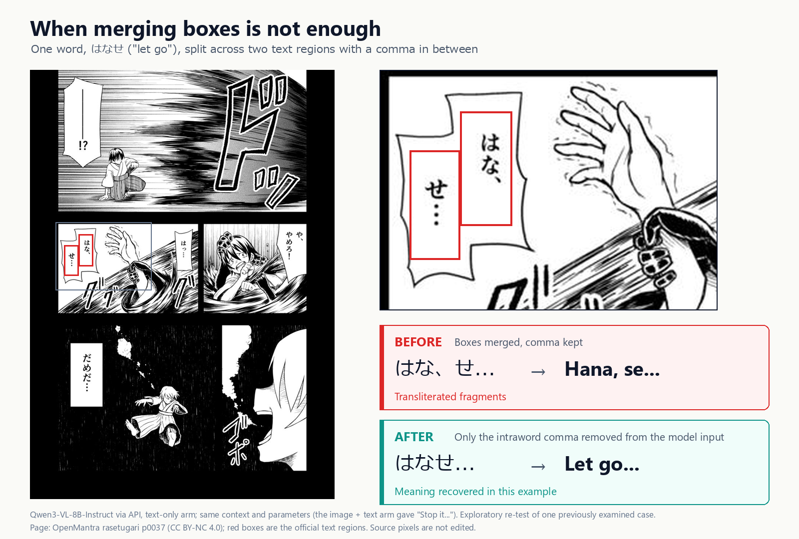

### 6. Remove text without damaging line art; typeset without truncating

- **Problem**: To fill English back into the original bubbles, the Japanese has to be removed first. LaMa needs to see the surrounding image to inpaint naturally, but if the entire cropped region is replaced, the bubble border and the nearby line art change along with it. English usually takes up more space than Japanese, and if text is simply cut off when it doesn't fit in the bubble, readers will think they're seeing the complete sentence.

- **Approach**: LaMa takes a larger context crop as input, but only the [pixels inside the mask (`_inpaint_patches()`)](vision/graphics.py) are pasted back into the original image, and the line art outside the mask stays unchanged; when crop regions overlap, the same pixel is never inpainted twice. The [font-size search (`layout_text()`)](vision/graphics.py) uses binary search between the minimum and maximum font sizes to find the largest size that fits; English words are never split, and when the text doesn't fit even at the minimum size, it is explicitly marked as overflow rather than arbitrarily truncated.

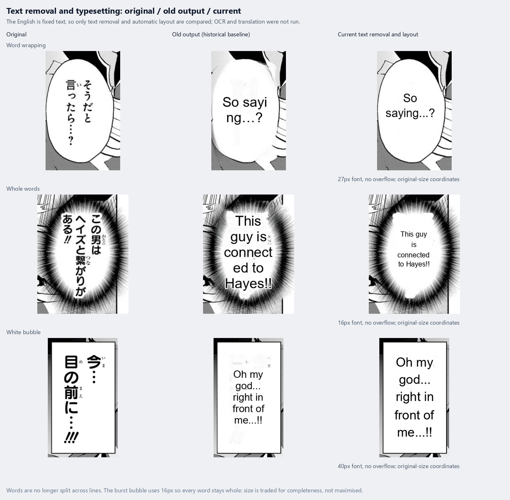

<details>
<summary>Verification</summary>

- **Verification**: [tests/test_graphics.py](tests/test_graphics.py) checks that LaMa composites only the pixels inside the mask, leaving bubble outlines and pixels outside the box unchanged; that the font-size search makes no more than 1 + ⌈log₂(number of candidate font sizes)⌉ measurements, and that the size it finds would overflow at 1 size larger; and that overlong words are marked as overflow, with overflowing bubbles neither erased nor rendered, keeping the original image.

</details>

> [!TIP]
> **What I learned**:
> - A model's input range and the range where its output takes effect can be designed separately: let it see a lot, but change little.
> - Thanks to the monotonic relationship "the larger the font size, the harder it is to fit," the default range of sizes 12–40 would take 29 tries in the worst case; now it takes at most 6.
> - Better to report "doesn't fit" explicitly than to truncate arbitrarily and let users think the result is complete.
>
> **Applied knowledge**: When CS50x used a phone book to teach binary search, the premise was that the names were already sorted. When searching for a font size there was no sorted list, and that's when I realized that what binary search really depends on is monotonicity: as long as "the larger the font size, the harder it is to fit" holds, half of the range can be ruled out each time.

## Data Layer: SQLite

The default database is `data/memory.sqlite3`, accessed directly through the standard library's `sqlite3`, with no ORM. The following 8 tables are created by [GlossaryMemory](core/memory.py). Data is isolated by work, and terms and translation jobs are also isolated by target language.

| Table | Data stored |
| --- | --- |
| `terms` | Source term, translated name, aliases, Japanese reading, lock status and the page where it first appeared |
| `term_pages` | Page OCR text and the work/language it belongs to |
| `term_dependencies` | Dependencies between terms and pages, to help locate pages that need updating |
| `glossary_imports` | Glossary import records, so that deleted seed entries are not re-imported after a restart |
| `characters` | Character ID, name and default voice |
| `character_bindings` | Bindings between page bubbles and characters, and whether the user has confirmed them |
| `character_samples` | Character image boxes and appearance feature samples marked by the user |
| `task_runs` | Batch job status, duration and report location |

- **Integrity**: Composite primary keys prevent duplicate records within the same work and language; foreign keys link pages, term dependencies and characters; all SQL uses `?` parameter binding.
- **Concurrency**: The UI and background jobs each use their own connection, with WAL enabled so that reads and writes can happen at the same time; migrating old tables uses `BEGIN IMMEDIATE`; updates use `ON CONFLICT ... DO UPDATE`.
- **Caching**: The term list detects commits from other connections through `PRAGMA data_version`, and writes on the same connection actively invalidate the cache.

> [!TIP]
> **Applied knowledge**: The Python for Everybody databases course got me used to writing SQL directly with `sqlite3`, and to using composite primary keys to keep records unique and represent many-to-many relationships. The difference is that in the course, a foreign key was just an integer column that the database didn't check; SQLite doesn't check foreign keys by default, so here I added `REFERENCES` constraints and turned on `PRAGMA foreign_keys` on every connection.

<details>
<summary>Runnable example: parameterized queries, indexes, WAL, 100 reads with only 1 SELECT, cross-connection refresh</summary>

Run it from the project root. It uses only a temporary database and loads no models.

```powershell
@'
from pathlib import Path
from tempfile import TemporaryDirectory
from core.memory import GlossaryMemory

with TemporaryDirectory() as folder:
    database = Path(folder) / "demo.sqlite3"
    with GlossaryMemory(database, "demo", "en") as memory:
        memory.upsert_term("Rin", "Rin", locked=True, user_edit=True)
        query = "SELECT target FROM terms WHERE work=? AND language=? AND source=?"
        params = ("demo", "en", "Rin")
        assert memory.connection.execute(query, params).fetchone()[0] == "Rin"
        plan = memory.connection.execute("EXPLAIN QUERY PLAN " + query, params).fetchone()["detail"]
        assert "USING INDEX" in plan, plan
        assert memory.connection.execute("PRAGMA journal_mode").fetchone()[0] == "wal"

        statements = []
        memory.connection.set_trace_callback(statements.append)
        try:
            for _ in range(100):
                assert memory.list_terms()[0]["target"] == "Rin"
        finally:
            memory.connection.set_trace_callback(None)
        selects = [sql for sql in statements if sql.lstrip().upper().startswith("SELECT")]
        assert len(selects) == 1, selects

        with GlossaryMemory(database, "demo", "en") as editor:
            editor.upsert_term("Rin", "Rin Aoki", locked=True, user_edit=True)
        assert memory.list_terms()[0]["target"] == "Rin Aoki"
        with GlossaryMemory(database, "another-work", "en") as other:
            assert other.list_terms() == []
        print(plan)
        print("PASS: parameter binding, index, WAL, 100 reads / 1 SELECT, refresh, isolation")
'@ | & '.\.venv\Scripts\python.exe' -
```

</details>


## What I Researched: Go/No-Go Decisions Based on Evidence

Once the pipeline worked end to end, the question shifted from "does it run?" to "which choice is actually better?" The three questions below were all tested under the same set of rules: the dataset is OpenMantra, with development and test sets split by work; configurations are frozen before the official runs; reference translations never enter the prompt; 95% intervals come from a page-paired bootstrap (2,000 iterations); failed translations are counted in the denominator as empty outputs rather than excluded; and any change made after seeing test results is labeled exploratory. The raw results and verification scripts behind every number are in [evidence/](evidence/README_EN.md).

### 1. Which local model should I use?

- **Problem**: The candidates that can run on an 8GB GPU are VNTL (a Japanese-to-English fine-tune of Llama 3 8B, Q4_K_M quantized) and Qwen2.5-3B-Instruct. From a few trial pages alone, it's hard to tell which is better, and a different few pages might reverse the conclusion.
- **How I tested**: Both models used the same official Japanese text and text boxes, translating region by region, with an output limit of 256 tokens and at most one retry on failure. I first debugged on the development works, then, after freezing, ran the first 24 pages of the test work tojime_no_siora, 224 regions in total; after that, I reran it on rasetugari, a work I hadn't used before (54 pages, 358 regions). The metric is chrF++, and tojime also has human review.
- **Results**: VNTL's chrF++ is higher than Qwen's by 2.497 [0.707, 4.503] (tojime) and 5.768 [3.873, 7.555] (rasetugari), and neither interval crosses zero; in the tojime human review, VNTL's severe-error rate is 14.89 percentage points lower [−28.26, −2.08]. Translation failures: VNTL 0/224 and 3/358; Qwen 1/224 and 11/358 ([tojime](evidence/results/test24-systems/comparison.json) · [rasetugari](evidence/results/riskflag/automatic/comparison.json) · [human review](evidence/results/R1/analysis/summary.json)).
- **Decision**: Use VNTL by default and keep Qwen as a comparison option.

> [!TIP]
> **What I learned**:
> - What's being compared is a "deployment configuration," not "the model itself": the two differ in parameter count, quantization and prompt format, so all I can say is "deployed this way on this machine, VNTL is better."
> - Only because both the direction and the interval replicated on a previously unused work does the conclusion hold up.
> - chrF++ only measures character and word overlap with the reference translation, which is not the same as a correct translation, so human review is needed as well.
>
> **Applied knowledge**: When CS224N covered machine translation evaluation, it pointed out that BLEU scores a translation by its n-gram overlap with the reference translation, but a sentence can be translated correctly in many ways, so a good translation may score low just because it uses different words. chrF++ is also an overlap metric, only computed over character and word n-grams; and here each sentence has only one reference translation, which makes this problem even more pronounced. So I treat it only as a reference, and severe errors have to be judged by a person.

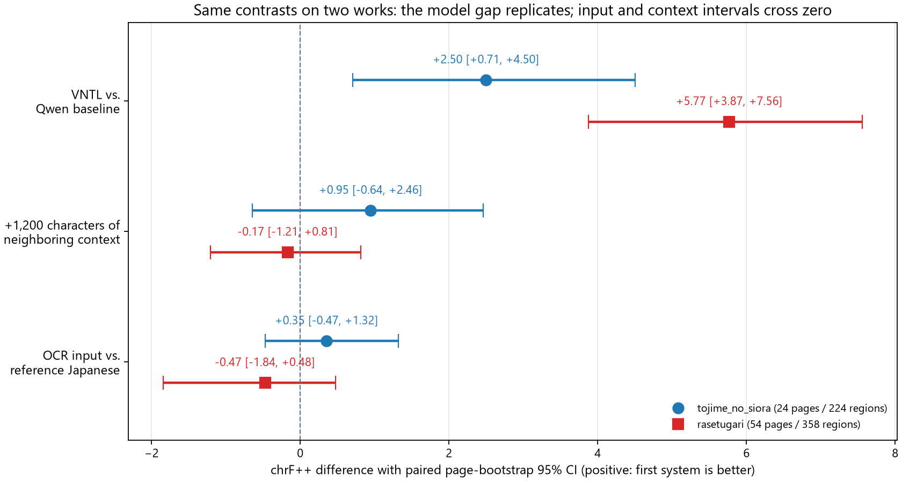

<sub>Both metrics are "differences on the same set of pages," not absolute scores: values above 0 on the horizontal axis mean the former is better. VNTL is higher than Qwen by 2.497 and 5.768, and neither interval crosses zero, so the result also replicates on the previously unused rasetugari; with OCR input and with 1200 characters of nearby context added, both intervals cross zero, meaning the direction of these two differences can't be told yet (this is the conclusion on chrF++; in the tojime human review, adding context lowered the severe-error rate by 10.87 percentage points [−19.57, −4.17])</sub>

### 2. How large is the OCR error?

- **Problem**: Translation input comes from OCR. If OCR gets a lot wrong, even switching to a better translation model won't help; but "how much is wrong" depends on how you count.
- **How I tested**: On the 224 official text boxes in the first 24 pages of the test work, I ran OCR on crops of those same boxes and compared the character error rate (CER) against the official Japanese, reporting two measures at once: a strict character-by-character comparison, and a comparison after unifying only full-width/half-width characters and whitespace. Then I switched the translation input from the official Japanese to the OCR output, kept all other conditions the same, and looked at how the translation scores changed.
- **Results**: Strict CER is 10.24% (266/2,598 characters), and only 1.89% (49/2,598 characters) after normalization; of the 224 regions, 78 differ only in formatting. With OCR input, the translation score barely changes: +0.353 [−0.472, 1.321], with an interval that crosses zero. But individual misread characters do carry through: p0001:t000 recognized 「シオラ」 as 「シボラ」, and the name in the translation changed from `Shiora` to `Shibo-ra` ([CER](evidence/results/test24-label/scores.json) · [case-by-case comparison](evidence/results/test24-label/cases.csv)).
- **Decision**: Keep the entry point for manually correcting OCR. The overall impact is small, but local errors such as names need a person to fix them.

> [!TIP]
> **What I learned**:
> - The same results, counted a different way, can differ by more than 5×. When reporting, give both measures and explain where they differ.
> - Average scores are insensitive to a small number of critical errors; errors such as names need to be looked at separately.
> - The score difference between the two inputs can't be read as "OCR accounts for X% of all errors": the differences at each stage can't be added together.

### 3. Can likely mistranslated bubbles be flagged in advance?

- **Problem**: Translations need manual proofreading, but a book has hundreds of bubbles, and checking them one by one takes too much time. If the 30% most likely to be mistranslated could be picked out automatically, proofreading could start with those. My idea was: if several systems translate the same sentence very differently, that sentence is probably harder and more likely to be mistranslated.
- **How I tested**: The risk score is the average chrF++ difference between the main system's translation and the translations of three other systems, without reading the reference translations or human labels. I first ran a pilot on the test work I had already looked at. After the results looked good, I preregistered the decision criteria: at a 30% review budget, the lower bound of the 95% interval for the recall gain over random selection must be greater than 0, and the lower bound of the AUROC interval must be greater than 0.5. It passes only if both hold ([protocol](evidence/results/riskflag/PROTOCOL_EN.md)). Then, on the previously unused work rasetugari, I froze a sample of 151 regions for human review and tested again.
- **Results**:

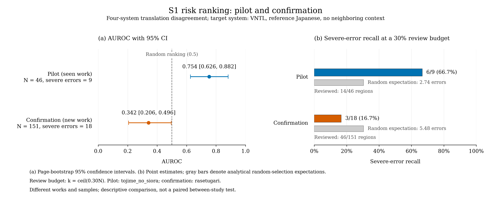

<sub>Across 151 regions, only the most suspicious 30% (the top 46) are checked. Severe errors fall toward the bottom of the ranking overall, so picking bubbles by disagreement score catches even fewer severe errors than random selection; this is the direct reason for dropping automatic flagging.</sub>

  On the new work, the ranking was worse than random, the opposite direction from the pilot ([report](evidence/results/riskflag/REPORT_EN.md)).
  
- **Decision**: **Abandon this direction.**

> [!TIP]
> **What I learned**:
> - Working on data you've already seen doesn't mean it works on new data. If I had looked only at the pilot results, this feature would have been built into the reader.
> - Decision criteria have to be set before seeing the results. If you pick the budget or the metric after the fact, you can always find one that "looks like it works."
> - A possible explanation I came up with: of the 18 severe errors on the new work, 15 are about who did what to whom or about cross-bubble correspondence, and the systems often get the same place wrong. When they're all wrong together, "disagreement" (the divergence signal) can't catch it. These errors stem from Japanese itself omitting subjects and from missing visual information; of the four systems compared, three are different settings of the same VNTL, all small local models with basically no context, so the clues they get and their ability to infer are similar; as a result, they guess wrong together and translate the same way, and disagreement ends up small. In that case, an AUROC below 0.5 (0.342) makes sense: the errors are concentrated where the systems agree. However, a larger API model given the whole page of Japanese could translate most of them correctly, which shows that at least some of the clues are in the text itself; the small models just didn't infer them.
> - Looking back, this was also a problem with the experimental design: three of the four systems used to compare disagreement were different settings of the same VNTL, so similar to each other that disagreement naturally couldn't show up. If I did it again, I would choose more diverse systems, such as models from different families or of different sizes, and then test whether disagreement can point to errors.
>
> **Applied knowledge**:
> - Two UW machine learning courses each correspond to one part of this design. The regression course stressed, when covering model selection, that the test set is evaluated only once, at the very end; once you've used it to pick a model, its test score no longer represents performance on new data. The tojime pilot had already been looked at and scored, which effectively turned it into a validation set, so the confirmation experiment switched to the previously unused rasetugari, with the decision criteria fixed before seeing the results. The classification course covered recall (how many of the real errors are found) and precision (how many of the flagged bubbles really have errors), which trade off against each other as the threshold changes. Here, what's fixed is the review budget, not a score threshold: the 30% of bubbles with the highest risk scores get checked, and the score cutoff this implies varies from work to work. With the budget fixed, the question is how many of the real errors that 30% catches, so the decision criteria look at recall, while precision is reported as well.

**Limitations**: Few works were evaluated, and I was the only judge. The judgments for both tojime and rasetugari were made and entered by me.

## Quick Start

Requires Windows, NVIDIA CUDA and Python 3.12. First set up CUDA PyTorch, the model weights and the local runtimes; click-to-listen additionally requires VOICEVOX. Bubble detection uses `best.pt` in the project root; the other models and runtimes have to be downloaded separately. See the [usage guide](USAGE_EN.md#installation) for installation steps.

```powershell
# Open the GUI and choose images or a folder
.\launch.bat

# Generate translated images in batch
.\run.bat "E:\Manga\Book1" -o ".\translated_output" --work "Book1" --offline

# Open existing results; click a bubble to see the English and hear the Japanese
.\run.bat --read ".\translated_output" --work "Book1" --offline
```


## Limitations

- Verified only on a single Windows + RTX 4070 Laptop machine; installation has not been tested on a fresh machine.
- Translations may still need manual proofreading, with particular attention to names, character relationships, cross-bubble correspondence, missing text and stylized lettering.
- Linked translation relies on candidate rules and can't recognize arbitrary cross-bubble relationships.


## Future Improvements

### 1. LoRA fine-tuning for manga translation (starting with who did what to whom)

The main problem left over from the research is getting **who did what to whom** wrong: the translation attributes an action to the wrong character, or reverses who does it to whom. But it isn't the only problem: the human review also recorded errors such as name readings, additions and omissions. VNTL is mainly aimed at visual novel translation, while manga dialogue is shorter, omits subjects more often, and is often cut apart by bubbles. So the goal of this fine-tuning is to adapt the model to manga translation, with these errors as the top priority.

**Why change the model itself**

- **Flagging missed them**: The confirmation experiment in [item 3](#3-can-likely-mistranslated-bubbles-be-flagged-in-advance) showed that disagreement-based flagging failed on the new work. Broken down by error type: the 15 severe errors about who did what to whom or cross-bubble correspondence had a median risk rank of 125th out of 151, nearly at the bottom; the 30% review budget caught only 2 of them, while random sampling would catch about 4.6 ([post hoc analysis](evidence/results/riskflag/POSTHOC_EN.md)). Non-severe regions ranked roughly in the middle, about the same as random. In other words, the systems tended to agree in the very places where the main system was wrong. So rather than trying to catch these errors after translation, I want to reduce them at the source, in the model itself (see [item 3](#3-can-likely-mistranslated-bubbles-be-flagged-in-advance) for the ranking chart).

  
- **A stronger model gets many of them right from the text alone**: In the text-only condition, qwen3.8-max fixed 11 of VNTL's 12 who-did-what-to-whom errors. This shows that most of these clues are in the text itself; the local model just didn't make use of them.

### 2. Add an optional API translation backend

**Why**

- **A larger API model is clearly better at working out who did what to whom**: In the research, I used qwen3.8-max on Alibaba Cloud Model Studio (Bailian) for text-only translation of 24 seen regions (with the whole page of Japanese given as context). It had severe errors on 2/24 (8.33%); on the same regions, local VNTL had 14/24 (58.33%), a difference of −50.00 percentage points [−69.23, −30.43]. Counting only who-did-what-to-whom errors, it was 2/24 versus 12/24, and the API fixed 11 of VNTL's 12 ([report](evidence/results/multimodal-api-qwen38/replacement-v1/REPORT_EN.md)).

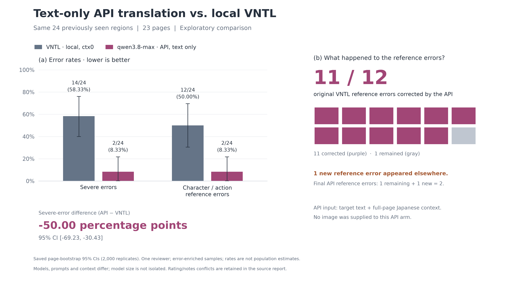


## License and Acknowledgments

This project's own source code is released under the [MIT License](LICENSE). The manga images in the repository (`presentation/`, `docs/assets/`) and the OpenMantra source text and reference translations in `evidence/` are not covered by the MIT License and are subject to their own licenses.

This project integrates existing models and engines. OpenMantra is CC BY-NC 4.0, Magi is for academic research use only, VNTL uses the Llama 3 license, and each VOICEVOX voice follows its own terms; copyright in the manga samples belongs to the original rights holders. See the [third-party notices](THIRD_PARTY.md) for details.
