# Learn English with Manga

[](https://github.com/Mrch1io/learn-english-with-manga/actions/workflows/tests.yml)

本地离线的日译英漫画翻译：检测 → OCR → 翻译 → 消字嵌字 → 点击气泡听日语原文。一块 8GB 笔记本显卡即可运行。

https://github.com/user-attachments/assets/218677d5-5a28-4c78-bfd8-8b410796a27d

[查看视频文件](demo-video/demo-30s-hq-zh.mp4)

[自学课程用在了哪里](#为这个项目学了什么)

[](USAGE.md#安装)
[](#数据层sqlite)
[](USAGE.md#安装)
[](ui/app.py)

[](vision/graphics.py)
[](translation/vntl.py)
[](vision/detection.py)
[](vision/detection.py)

**语言 / Language**: [English](README.md) | 简体中文

## 为什么做

笔者作为自学日语的一名资深二次元，在面对要命的英语考试的需求，琢磨着为什么不能边看漫画边提升自己的英语水平呢？于是有了这个项目。由于作者本人比较cost-conscious, 所以首选了部署本地大模型完成翻译工作。

等我真正测试了初版原型后，才发现问题不仅仅限于翻译出来，还有：一句话被拆进两个气泡怎么办？同一个人名前后译法不一样怎么办？英文读着通顺，“谁对谁做了什么”却翻反了怎么办？这些问题大都得到了对应的解决，未解决的问题也成为了日后研究的方向。

## 效果展示

| 日文原图 | 导出的英文译图 |
| --- | --- |
|  |  |

<sub>VNTL 翻译结果展示：一句话跨两个气泡，作为整句翻译后再分配回原框。</sub>

| 整页原图 | VNTL 自动输出（未人工修改） |
| --- | --- |
|  |  |

<sub>OpenMantra 测试作品 tojime_no_siora 第 3 页，输出：Manga-OCR 识别、VNTL 翻译、自动清字和排版。图里也能看到没解决的问题：同一个家族名先译成 `Tortillano`，后面又译成 `Torutiano`，这也是后面要用术语表锁定译名的原因。</sub>

## 应用界面


| 任务窗口                                 | 设置                                                      |
| ------------------------------------ | ------------------------------------------------------- |
|  |  |


## ✨ 核心功能

### 翻译与术语管理

- 🔍 **漫画文字检测** - 结合 YOLO 气泡检测与 Magi 整页文字补检，识别对白、旁白及气泡外文字
- 📝 **日文 OCR** - 使用 Manga-OCR 识别漫画日文，可选启用 PaddleOCR-VL 补充处理低置信度结果
- 💻 **本地日译英** - 默认使用 VNTL 模型；模型准备完成后可离线运行（日后提供api）
- 💬 **上下文辅助翻译** - 将邻近对白、相关术语和人工确认的角色信息提供给模型，辅助理解当前气泡
- 🔗 **跨气泡关联翻译** - 根据阅读顺序、位置和文本规则关联部分被拆开的句子，整句翻译后将英文分配回原气泡
- 📚 **作品独立术语库** - 使用 SQLite 保存人名、专有名词、别名和日语读音。

### 漫画阅读与日语点读

- 📖 **批量翻译** - 导入文件夹，即可按自然顺序浏览页面，可在日文原图与英文译图之间切换
- 🔊 **点击气泡朗读日语** - 接入VOICEVOX，点击气泡即可朗读对应日文
- 🎭 **角色与声线管理** - 为角色绑定对白和默认声线，按作品保存并跨页复用
- 👤 **角色关联建议** - 可选使用 Magi 提供人物与对白的关联建议

### 清字、排版与校对

- 🧹 **原文清除与背景修复** - 根据文字掩膜处理原文，结合纯色填充与 LaMa 修复背景，并保护明显边框和线条
- 🎈 **英文自动排版** - 按气泡可用区域测量文字宽高，自动换行和调整字号
- ✏️ **校对** - 支持人工审阅 OCR 原文和英文译文，支持局部原图与译图对照并局部更新

### 批量处理与本地运行

- 📦 **文件夹批量翻译** - 支持多图及子文件夹处理，记录每页状态，单页失败后继续处理后续页面
- ⚡ **先阅读、后导出** - 可先保存识别与翻译文本用于点读，之后按需生成译图，无需重复检测、OCR 和翻译

## 架构

```mermaid
%%{init: {"theme": "base", "themeVariables": {"fontFamily": "Inter, Segoe UI, Arial, sans-serif", "fontSize": "14px", "lineColor": "#94A3B8", "primaryTextColor": "#1E293B"}, "flowchart": {"curve": "basis", "nodeSpacing": 32, "rankSpacing": 40, "padding": 16}}}%%
flowchart LR
    IN["CLI / GUI / Folder Batch"] --> PIPE["pipeline.process_page<br/>Three entry points · one pipeline"]
    PIPE --> DET["Detection<br/>YOLO + Magi"]
    DET --> OCR["Japanese OCR<br/>Manga-OCR"]
    OCR --> TR["Translation<br/>VNTL 8B · llama.cpp"]
    TR --> LAY["Layout Preflight<br/>Pillow"]
    LAY --> INP["Text Removal<br/>LaMa"]
    INP --> REN["Render English Text"]
    REN --> OUT[("Translated PNG + Page JSON<br/>Per-file atomic writes · hash check")]
    DB[("SQLite<br/>Terms / Aliases / Characters")] <--> TR
    POOL["ModelPool<br/>GPU Memory Scheduling"] -.-> DET
    POOL -.-> OCR
    POOL -.-> INP
    OUT --> READ["Reader<br/>Click-to-Listen · VOICEVOX"]
    OUT --> EDIT["Proofreader<br/>English: reflow only<br/>Japanese: retranslate, update the edited bubble only"]
    EDIT --> OUT

    classDef entry fill:#0F172A,stroke:#0F172A,color:#FFFFFF,stroke-width:1.5px,rx:12,ry:12;
    classDef process fill:#EEF2FF,stroke:#A5B4FC,color:#312E81,stroke-width:1.5px,rx:10,ry:10;
    classDef graphics fill:#F0FDFA,stroke:#5EEAD4,color:#115E59,stroke-width:1.5px,rx:10,ry:10;
    classDef storage fill:#FFFBEB,stroke:#FCD34D,color:#78350F,stroke-width:1.5px;
    classDef support fill:#F8FAFC,stroke:#CBD5E1,color:#475569,stroke-width:1.5px,rx:10,ry:10;
    classDef application fill:#EFF6FF,stroke:#93C5FD,color:#1E3A8A,stroke-width:1.5px,rx:10,ry:10;

    class IN,PIPE entry;
    class DET,OCR,TR process;
    class LAY,INP,REN graphics;
    class OUT,DB storage;
    class POOL support;
    class READ,EDIT application;
    linkStyle default stroke:#94A3B8,stroke-width:1.5px;
```




## 我的早期实践：训练 YOLO 气泡检测模型

项目早期，我在 YOLOv8m 预训练权重上训练了漫画气泡检测模型（`Bubble with Text`），所得 `best.pt` 沿用于单图和批量翻译。它先框出有字的气泡，再裁图交给 Manga-OCR，所以漏检或框偏会直接影响识别；目前另用 Magi 补充文字区域检测。训练统一使用 [tools/train.py](tools/train.py)，可指定数据集、初始权重和训练轮数；以已有 `best.pt` 为初始权重即可微调，命令见[训练说明](USAGE.md#训练气泡检测器)。权重由 [`detect()`](vision/detection.py) 加载。

## 我做了什么

以这个检测模型为起点，我搭起了从翻译到阅读的完整流程：

- **共享处理流程** [pipeline/batch.py](pipeline/batch.py)：批处理、自然排序、逐页错误隔离、可取消、结果缓存，以及逐文件原子写入与哈希校验。
- **本地翻译后端** [translation/vntl.py](translation/vntl.py)：接入 VNTL Llama3 8B（GGUF Q4_K_M），由任务自己启动的 llama.cpp 本地服务推理，用 GBNF 语法约束输出。
- **术语与角色数据层** [core/memory.py](core/memory.py)：8 张 SQLite 表，数据都按作品隔离，术语和翻译任务还按目标语言隔离。
- **阅读、校对与点读** [reader/window.py](reader/window.py) · [pipeline/editing.py](pipeline/editing.py) · [ui/app.py](ui/app.py) · [audio/speech.py](audio/speech.py)。
- **评测实践**：冻结、评分、bootstrap 与盲评材料生成
- **离线回归** [tests/](tests/)：模型、CUDA、HTTP 和语音都用测试替身，不加载权重、不调用付费 API

### 为这个项目学了什么
不论是在刚做这个项目，还是后来优化的时候，我都没有接受过系统性的计算机教育，这一直是我的一个缺憾。在这段自学的路上，特别感谢同校照顾我的老师，网友还有AI, AI 像老师一样帮了我很多：不论是给我推荐相关课程，还是针对具体问题给出解决意见。下面几个难点，就是我在各种自学的过程中一点点弄懂的，每项按"问题 → 做法 → 验证 → 学到了什么"记录。

各门课分别用在了哪个难点里，展示如下，点链接可以直接跳到对应小节：

| 自学课程 | 学到的 → 用在了哪里 |
| --- | --- |
| CS50x | 二分查找 → [字号搜索最多试 6 次](#6-清字不伤线稿排版不截断)；事务 → [三份文件一起保存，崩溃也不毁掉已有校对](#3-保存到一半如果突然崩溃不能毁掉人工校对文件) |
| Python for Everybody | 用 SQLite 缓存结果 → [判断缓存何时失效](#4-改一个字不该重跑整页-把翻译的英文名字-haru-改成-haruya)；外键约束 → [术语库数据层](#数据层sqlite) |
| Algorithms | TSP 的状态压缩 → [锁定人名的语法状态从 n! 级降到 2ⁿ 级](#2-明明锁定了人名模型为什么还是换译法改编号)；复杂度分析 → [只比较相邻气泡](#5-一句话被拆进两个气泡) |
| UW 机器学习 | 测试集只在最后用一次 → [换没用过的作品做确认实验](#3-能不能提前标出可能译错的气泡)；误报代价高时优先精确率 → [拿不准就不合并](#5-一句话被拆进两个气泡) |
| CS224N | 重合度指标的局限 → [chrF++ 只作参考，另做人工评审](#1-该用哪个本地模型) |
| CS336 | 资源核算 → [把几个模型塞进 8GB 显存](#1-8gb-显存放不下所有模型跑到一半就报-cuda-out-of-memory)；约束解码 → [先改输入，语法只兜底](#2-明明锁定了人名模型为什么还是换译法改编号)；BPE 分词 → [去掉词内逗号](#5-一句话被拆进两个气泡) |

## 我遇到的问题：

### 1. 8GB 显存放不下所有模型：跑到一半就报 CUDA out of memory

- **做法**：
  - 翻译用的 VNTL 8B 量化为 Q4_K_M（约 4.9GB），由 llama.cpp 常驻 GPU。
  - 检测、OCR、清字模型由 [`ModelPool`](core/runtime.py) 按阶段轮流使用 GPU，暂时不用的权重留在内存，同一批任务里每个模型只加载一次。进入每个阶段前先确认剩余显存够不够这一阶段的预算，不够就先关掉翻译服务，需要时再启动。
  - 显存不足时，先把其他模型都挪回内存，再把当前阶段重试一次，不会无限重跑。出错时还会清理异常栈，避免失败留下的张量继续占着显存。
  - Qwen2.5-3B 对照模型挪回内存之前，先检查 Windows 还能分配多少内存（commit），不够就直接释放，下一页再重新加载。
  
- **约束**：推理只走 CUDA，没有 GPU 时直接报错，不会悄悄退回 CPU。

<details>
<summary>验证</summary>

- **验证**：[tests/test_models.py](tests/test_models.py) 断言四件事：权重只加载一次；剩余显存不够阶段预算时先关掉翻译服务；显存不足只重试一次；内存不够时释放而不是复制；没有 CUDA 时直接报错。

</details>

> [!TIP]
> **从中学到**：
> - 先算资源再动手：只算权重，8B 模型用 fp16 就要约 16GB（80 亿 × 2 字节），8GB 显卡放不下；量化到 Q4_K_M 后约 4.9GB，才给 KV cache 和其他模型留出空间。卸载 Qwen 模型前，代码同样先按张量的实际字节数核算，再决定复制回内存还是直接释放（[`ModelPool.offload()`](core/runtime.py)）。
> - 模型在 CPU 和 GPU 之间是整份搬运的（`.to(device)`），挪回内存时，内存里同样要腾出一整份空间。
> - `torch.cuda.empty_cache()` 只把缓存里闲置的显存还给驱动，仍被引用的张量不会因此释放。
> - 异常的 traceback 会引用出错时的栈帧，栈帧里的中间张量也就一直释放不掉。
> - Windows 的可分配内存（commit）和空闲内存不是一回事：看起来内存还有空余，commit 不够照样会分配失败。
> - 归根结底，显存问题分两层：先把账算清楚，看模型加起来能不能放下；再看谁还持有引用、什么时候释放。资源要有明确的生命周期，不能指望垃圾回收替我收拾。
>
> **应用知识**：CS336 中资源核算的部分；PyTorch 文档中 CUDA 语义的显存管理部分；在每一步前后用 `torch.cuda.mem_get_info()` 打印剩余显存，做实验对比。

### 2. 明明锁定了人名，模型为什么还是换译法、改编号？

- **问题**：术语表把「美咲」和昵称「みーちゃん」都锁定为 `Misaki Takanashi`。修复前，VNTL 把「みーちゃん、その鍵はどこ？」译成 `Mii-chan, where's that key?`，把「美咲、先に白銀門へ行って。」译成 `Misaki, go ahead to Silver Gate.`，都没有用锁定的全名。名字还必须出现在含有对应日文的那个气泡里，不能因为隔壁气泡出现过一次就算满足。更早还有一个问题：未经约束的 VNTL 曾把气泡编号改成大写、改写较长的编号，甚至把不同气泡的编号全部改成角色名 `Kenta`。编号一乱，译文就对不回气泡，也不能按位置去猜。

- **做法**：分三层。
  - 输入：先[预检（`validate_input()`）](translation/vntl.py)：含有模型保留控制符（`<|`、`|>`）、锁定名超过 4 个或总长超过 256 个字符的输入，在加载模型和分词之前就被拦下，同组其他气泡照常翻译。再[按精确范围（`_locked_source()`）](translation/vntl.py)把已锁定的原名和别名换成锁定的英文拼写；存盘的 OCR、日语点读和页面原文仍是日文。同一段日文对应两个不同译名时，也在这一步报歧义，请用户先改术语表。
  - 解码：用 llama.cpp 的 [GBNF 语法（`label_grammar()`）](translation/vntl.py)约束生成。气泡编号和出现顺序由语法固定，模型只能生成编号后面的英文。每个气泡单独一行，这一行必须包含它自己原文命中的全部锁定名，顺序不限，名字两侧必须是拉丁词边界。
  - 输出：生成结束后再检查一次，不满足就明确失败、保留原文，不对生成的英文做替换。

  [语法的状态（`_locked_line_grammar()`）](translation/vntl.py)用位掩码记录"哪些锁定名已经出现"，再加一位记录上一个名字结尾是否需要词边界；相同状态复用同一条规则。四个名字时，记录顺序要 65 种前缀状态，只记录集合只要 2⁴ = 16 种，加上词边界标记最多 32 种。普通词语不受约束，英语词序仍然自由。
  
<details>
<summary>验证</summary>

- **验证**：
  - 真实模型：最初只加语法约束、没做输入规范化时，有 4 处结果因达到 token 上限、输出不完整而失败。加入输入规范化后，两句分别译成 `Misaki Takanashi, where is that key?` 和 `Misaki Takanashi, go to Silver Gate first.`（[跟进记录](evidence/validation/VNTL.md)）。
  - 语法测试：[tests/test_vntl_locked_terms.py](tests/test_vntl_locked_terms.py) 检查全名必须出现在自己的气泡，只写 `Misaki` 或写进隔壁气泡都不通过；`Hannah`、`Annie` 不能冒充 `Ann`；四个名字任意顺序都能通过，缺一个就不通过，规则不超过 32 条；歧义、超长或格式错误的锁定词明确报错。
  - 预检测试：[tests/test_translation_input_validation.py](tests/test_translation_input_validation.py) 检查坏输入在加载模型、构建提示词和分词之前就被拒绝；组里一个坏气泡不拖累相邻的好气泡；直连服务时，语法在发出任何 HTTP 请求之前先校验。
  - llama.cpp 原生语法采样器：14 项接受／拒绝判定全部符合预期（[记录](evidence/validation/vntl-grammar.json)），只加载词表，不加载推理权重。

</details>

> [!TIP]
> **从中学到**：
> - 解码约束只能排除，不能让模型"想到"。语法规定这一行在写出全名之前不能结束，可模型读到的仍是「みーちゃん」，几乎不会主动写出全名，于是只能在允许的范围里一直写下去，直到 token 上限。先把输入改成全名，模型自己就会写出它，语法只负责兜底。
> - 只记录"哪些出现过"、不记录顺序，状态数就从随 n! 增长变成随 2ⁿ 增长；再给锁定名的数量设上限，语法的大小就有了保证。
> - 能在便宜的阶段发现的错误，就不要留到昂贵的阶段：检查控制符和锁定名只是字符串操作，加载模型再生成一轮要贵得多，失败了还得重来。
> - 提示词里的要求，要转化成程序能检查的条件。但拼写和位置都满足，也不代表语义正确：报告里其他句子仍有需要人工修正的译文。
>
> **应用知识**：
> - CS336 讲推理时，模型每一步给词表里每个 token 算出一个分数（logits），转成概率后选出下一个 token。llama.cpp 的语法约束在选之前，把会违反语法的 token 的分数设为负无穷，概率变成 0，其余 token 之间的相对大小不变。项目里生成时[温度设为 0（`VntlServer.generate()`）](translation/vntl.py)，每一步都选剩下的 token 中分数最高的那个。所以约束改变的是"能选什么"，不是模型"想选什么"。
> -  Algorithms 课讲旅行商问题时，暴力枚举要试 n! 条路线；动态规划把状态定为"已经访问过的城市集合 + 当前所在的城市"，同一个状态只算一次，计算量降到 O(n²·2ⁿ)。设计锁定名的语法状态时，我借用了这个思路：状态是"已经出现过的名字集合 + 一位词边界标记"，集合用二进制位表示，每写出一个新名字就把对应的位置 1，相同状态复用同一条语法规则。


### 3. 保存到一半如果突然崩溃，不能毁掉人工校对文件

- **问题**：批量翻译每处理完一页、校对器里每保存一次修改，程序都要同时更新三份文件：清字底图、译图，以及记录每个气泡原文、译文和人工修订的 JSON。保存时如果中途出错，可能出现"图已经是新的、JSON 还是旧的"，或者文件只写了一半。翻译可以重跑，人工校对丢了就很麻烦。

- **做法**：[`_commit_files()`](pipeline/batch.py) 分两步提交：先把每份文件写进同一目录下的临时文件并 `fsync`，同时备份旧文件；全部写好后，再用 `os.replace` 依次替换，JSON 放在最后。替换时遇到普通的写盘错误，就用备份逐个还原；连还原也失败时，保留备份并在报错里写明位置。但如果遇到突然退出，回滚代码根本不会运行，而多个文件的替换无法做到原子，所以 JSON 里记录每张图的 SHA-256，下次打开时[核对（`PageEditorSession.__init__()`）](pipeline/editing.py)，图和记录对不上就拒绝编辑，不覆盖。

<details>
<summary>验证</summary>

- **验证**：[tests/test_editing.py](tests/test_editing.py) 模拟写盘失败，检查译图、清字底图和 JSON 一起回滚；取消和翻译失败时不提交半成品；被外部改过的译图、损坏的底图在打开和保存时都会被拒绝。[tests/test_pipeline.py](tests/test_pipeline.py) 让三份文件的每一次替换分别失败，并模拟"图写完、JSON 没写"时崩溃，确认重启后不会覆盖这张孤立的图。

</details>

> [!TIP]
> **从中学到**：
> - `write` 返回不代表数据已经写进磁盘，`fsync` 才要求系统把它写下去。`os.replace` 只做一次重命名，读到的要么是旧文件、要么是新文件，不会是写了一半的。临时文件建在目标文件旁边，是因为重命名只能在同一个文件系统里完成。
> - 单个文件能做到"要么全成、要么不变"，多个文件放在一起就做不到。做不到完全保证时，退一步让错误能被发现：先写图、最后写 JSON，旧 JSON 里的哈希和新图对不上，下次打开就知道这次保存没完成。
>
> **应用知识**：CS50x 的 SQL教会过我，数据库靠事务保证一组修改要么全部生效、要么全部不生效。我的三份文件没有数据库托底，于是去查文件系统本身能保证什么。


### 4. 改一个字，不该重跑整页 （把翻译的英文名字 `Haru` 改成 `Haruya`）

- **问题**：一页要依次经过检测、OCR、翻译、清字和排版。比如把角色 ハル 的译名从 `Haru` 改成 `Haruya`：如果每次改动都整页、整批重跑，改一个名字就要等整本书重新处理一遍；可如果缓存判断错了，又会把还写着 `Haru` 的旧结果当成最新的。

- **做法**：
  - 在[校对器（`PageEditorSession._edit()`）](pipeline/editing.py)里把某个气泡的 `Haru` 改成 `Haruya`，属于英文修改：不跑 OCR 和翻译，只重新排版这一个气泡。改日文原文才重译：独立的气泡单独重译；和相邻气泡关联成一句的，整句一起重译。不管哪种，都只替换当前气泡的英文；如果相邻气泡现有的英文和新译文对不上，校对器会提示你去检查。
  - 在术语表里改掉 ハル 的译名再跑批量时，一页只有在缓存记录的几项都和现在一致时才会跳过：输入图的 SHA-256、[配置指纹（`configuration_fingerprint()`）](pipeline/batch.py)（配置、源码和模型文件）、本页原文实际命中的术语、本页已确认的说话人，以及已有译图和底图的哈希。所以原文里出现 ハル 的页面会重新处理，其他页面直接跳过。已经人工校对过的页面不会被自动覆盖，而是标成"需要复核"，由读者决定。
  - 5GB 的 GGUF 权重只比较路径、大小和修改时间，否则每次改字都要先读一遍 5GB 文件。

<details>
<summary>案例</summary>

- **案例**：[tests/test_pipeline.py](tests/test_pipeline.py) 用的正是改译名的场景：把 カナ 的译名从 `Kana` 改成 `Kanna` 后，用到它的页面重新处理；新增一个无关术语（東京 → `Tokyo`）时照常跳过。输入图、配置、新增的别名和已确认说话人的变化同样会让缓存失效；暂定的身份和语音设置不会；计算指纹时不读取 GGUF 权重；被手动改过的译图不会被当成有效缓存；有人工修订的页面在缓存失效后保持原样，直到显式使用 `--force`。

</details>

> [!TIP]
> **从中学到**：
> - 缓存难的不是存，而是判断什么时候失效。条件定得太宽，加一个无关术语就整批重跑；定得太窄，就会把还写着 `Haru` 的旧页当成最新的。所以测试要两面写：该失效的失效，不该失效的不失效。
> - 依赖要细到"这一页实际用到的"：术语表变了，不等于每一页都受影响。目前批处理的粒度是页，一页里只要有一处出现 ハル，整页都会重新处理；只重译相关气泡的更细粒度，现在只在校对器里有。
> - 只比较大小和修改时间是有意的取舍：内容变了而大小和时间都没变时会漏掉，换来的是每次不用读 5GB；完整的 SHA-256 保留在下载记录里。这种取舍需要写成注释。
>
> **应用知识**：Python for Everybody 数据库课里的地理编码作业（`geoload.py`）会把查过的地址和结果存进 SQLite，再跑时先查数据库，查到就跳过，所以程序中途停了也能接着跑。但那里的缓存只认地址，存进去就不再更新。我的结果还取决于配置、术语和模型，所以要多解决一个问题：存下来的结果什么时候不再可信？


### 5. 一句话被拆进两个气泡

- **问题**：漫画常把一句话拆进相邻的两个气泡，比如前一个以「読んじゃ」结尾，后一个以「ダメ」开头，合起来才是"不准读"。逐个气泡翻译时，每一半都不是完整的句子，模型只能猜。

- **做法**：[`continuation_pairs()`](translation/vntl.py) 只按阅读顺序比较相邻的两个框，复杂度 O(n + 字符数)，不枚举全页的框对。合并有两种依据：明确的语法接续（如「〜ちゃ」+「ダメ」表示禁止，「〜ても」+「いい」表示许可），或者位置相邻、字号相近、前半句明显没说完的短片段。OCR 失败、已确认是不同说话人、已经说完的句子和闭合的引号都不合并。找到的片段作为整句翻译，再分配回原来的框。如果一个词被拆开、中间夹了逗号，比如「はな、」+「せ…」合起来是「はなせ…」（"放开"），[分词检查（`normalize_word_boundary()`）](translation/vntl.py)只在有跨边界成词证据时才去掉这个逗号，而且只改送给模型的文本，OCR 原文不动。

<details>
<summary>验证</summary>

- **验证**：
  - 规则：[tests/test_vntl_continuations.py](tests/test_vntl_continuations.py) 和 [tests/test_fragment_links.py](tests/test_fragment_links.py) 检查完整句子、引号和无关对白不会被合并；不同说话人、OCR 失败的框保持独立；三个片段连成一串时不随意配对；整句译文分回原框后，每个词只出现一次。[tests/test_word_boundary.py](tests/test_word_boundary.py) 检查「はな、」+「せ…」会去掉逗号；「はな、」+「そう…」和「あれ、」+「これ」虽然拼起来也是词典里的词，但保持原样；「はな」被锁定为人名时也保留逗号。
  - 速度：在 i9-13980HX 上的无模型微基准（预热后 5 次取中位数）：

    |   测试项目   |  20 个框   |  200 个框  | 2,000 个框  |
    | :------: | :------: | :------: | :-------: |
    | 关联候选扫描耗时 | 0.119 ms | 1.117 ms | 15.188 ms |

    框数每增加 10 倍，耗时增加约 9～14 倍，接近线性；如果两两比较，应接近 100 倍。2,000 个框加上词内逗号判断，首次 56.1 ms，预热后中位数 18.1 ms（[扫描记录](evidence/validation/fragment-bench.json) · [词内逗号记录](evidence/validation/boundary-bench.json)）。相邻片段扫描可运行 [tools/benchmark_fragments.py](tools/benchmark_fragments.py) 复测，无需模型或 CUDA。

</details>

> [!TIP]
> **从中学到**：
> - 先想清楚问题的结构：按阅读顺序，只有相邻的框才可能接续，所以不用比较所有框对。
> - 复杂度可以用实测核对：看规模放大 10 倍时耗时放大多少倍，比只写一个 O(n) 更可靠。20 个框只要 0.119 ms，和模型推理相比可以忽略；测到 2,000 个框，是为了确认它不会随规模平方增长。
> - 拿不准就不合并：漏合并最多译得生硬，误合并会把两个人的话混成一句。规则只覆盖常见句式，边界要写清楚。
> - 分词器会先在标点处把文本切开，BPE 的合并不会跨过这个边界。所以词中间多出来的逗号，会让模型看到两个被切开的片段，而不是一个词。但拼起来是词典里的词还不够：「はな、」+「そう」能拼成「はなそう」，可「そう」本身也能单独成句（"是啊"）。所以还要求后半段只能是助词、助动词这类不能单独使用的成分。
>
> **应用知识**：
> - Algorithms 课反复追问"能不能比暴力枚举做得更好"，这让我先去找问题本身的结构。课程对复杂度分析的强调，又让我关注候选数量怎样随框数增长：两两比较要检查 n(n−1)/2 对，只看相邻的框只需 n−1 对。课上做的是理论分析；用实测的增长倍数检验这个分析在代码里是否成立，是我自己补的一步。
> - UW 机器学习分类课讲精确率和召回率时提到，误报代价高的场景要优先保证精确率。"拿不准就不合并"就是照这个思路定的。
> - **CS336（这一点对我最有意义）**：有个问题困扰了我许久：明明已经把两个框合成一句送给模型，为什么译出来还是断的？用 Qwen3-VL-8B 复测「はな、」+「せ…」时，合并后的整句仍被音译成 `Hana, se...`。 这次的问题加深了CS336 中 BPE 给我带来的知识点，分词器会先在标点处把文本切开，合并不会跨过这个边界。于是我怀疑：拼接只去掉了气泡边界，夹在中间的逗号还在把这个词切开。于是只去掉这个逗号、其余输入完全不变再测一次，成功译成了 `Let go...`，恢复了"放开"的意思；图文条件变成 `Stop it...`，不再音译，但意思更泛。这让我认识到，**气泡边界不等于语言单位边界**，输入怎么切分会直接影响翻译。
>
> 

### 6. 清字不伤线稿，排版不截断

- **问题**：英文要填回原来的气泡，得先把日文清掉。LaMa 修复要看到周围的画面才能补得自然，可如果把整块裁切区域都替换掉，气泡边框和旁边的线稿也会跟着变。英文通常比日文占地方，气泡放不下时如果直接截断，读者会以为看到的是完整的句子。

- **做法**：LaMa 用较大的上下文裁切作为输入，但只把[掩膜内的像素（`_inpaint_patches()`）](vision/graphics.py)贴回原图，掩膜外的线稿保持不变；裁切区域重叠时，同一处像素不会被修两次。[字号搜索（`layout_text()`）](vision/graphics.py)在最小和最大字号之间用二分法找能放下的最大字号；英文单词不拆开，最小字号也放不下时明确标记为溢出，不随意截断。


<details>
<summary>验证</summary>

- **验证**：[tests/test_graphics.py](tests/test_graphics.py) 检查 LaMa 只合成掩膜内的像素，气泡轮廓和框外像素保持不变；字号搜索的测量次数不超过 1 + ⌈log₂(候选字号数)⌉，且找到的字号再大 1 号就会溢出；超长单词被标记为溢出，溢出的气泡不擦除、不渲染，保留原图。

</details>

> [!TIP]
> **从中学到**：
> - 模型的输入范围和输出的生效范围可以分开设计：给它看得多，让它改得少。
> - 有了"字号越大越难放下"这个单调关系，默认 12～40 号之间最坏要试 29 次，现在最多 6 次。
> - 宁可明确报"放不下"，也不要随意截断，让用户误以为结果完整。
>
> **应用知识**：CS50x 用电话簿讲二分查找时，前提是名字已经排好序。找字号时没有排好序的列表，我才意识到二分真正依赖的是单调性：只要"字号越大越难放下"成立，就能每次排除一半。

## 数据层：SQLite

默认数据库为 `data/memory.sqlite3`，用标准库 `sqlite3` 直接访问，没有 ORM。以下 8 张表由 [GlossaryMemory](core/memory.py) 创建，数据按作品隔离，术语和翻译任务还按目标语言隔离。

| 表 | 保存的数据 |
| --- | --- |
| `terms` | 原词、译名、别名、日语读音、锁定状态与首次出现页面 |
| `term_pages` | 页面 OCR 文本与所属作品／语言 |
| `term_dependencies` | 术语与页面之间的依赖，辅助定位需要更新的页面 |
| `glossary_imports` | 词库导入记录，避免重启后重新导入已删除的种子词条 |
| `characters` | 角色 ID、名称和默认声线 |
| `character_bindings` | 页面气泡与角色的绑定，以及是否经过用户确认 |
| `character_samples` | 用户标记的角色图框和外观特征样本 |
| `task_runs` | 批处理任务状态、耗时和报告位置 |

- **完整性**：用复合主键防止同一作品、同一语言内的重复记录；用外键关联页面、术语依赖和角色；所有 SQL 都用 `?` 参数绑定。
- **并发**：界面和后台任务各用一个连接，开启 WAL 让读写可以同时进行；迁移旧表时用 `BEGIN IMMEDIATE`；更新用 `ON CONFLICT ... DO UPDATE`。
- **缓存**：术语列表通过 `PRAGMA data_version` 感知其他连接的提交，本连接写入时主动让缓存失效。

> [!TIP]
> **运用知识**：Python for Everybody 的数据库课让我习惯了直接用 `sqlite3` 写 SQL，并用复合主键保证记录唯一、表示多对多关系。不同的是，课上的外键只是一列整数，数据库并不检查；SQLite 默认不检查外键，所以这里加了 `REFERENCES` 约束，并在每个连接上打开 `PRAGMA foreign_keys`。

<details>
<summary>可运行示例：参数化查询、索引、WAL、100 次读取只执行 1 次 SELECT、跨连接刷新</summary>

在项目根目录运行。只使用临时数据库，不加载模型。

```powershell
@'
from pathlib import Path
from tempfile import TemporaryDirectory
from core.memory import GlossaryMemory

with TemporaryDirectory() as folder:
    database = Path(folder) / "demo.sqlite3"
    with GlossaryMemory(database, "demo", "en") as memory:
        memory.upsert_term("Rin", "Rin", locked=True, user_edit=True)
        query = "SELECT target FROM terms WHERE work=? AND language=? AND source=?"
        params = ("demo", "en", "Rin")
        assert memory.connection.execute(query, params).fetchone()[0] == "Rin"
        plan = memory.connection.execute("EXPLAIN QUERY PLAN " + query, params).fetchone()["detail"]
        assert "USING INDEX" in plan, plan
        assert memory.connection.execute("PRAGMA journal_mode").fetchone()[0] == "wal"

        statements = []
        memory.connection.set_trace_callback(statements.append)
        try:
            for _ in range(100):
                assert memory.list_terms()[0]["target"] == "Rin"
        finally:
            memory.connection.set_trace_callback(None)
        selects = [sql for sql in statements if sql.lstrip().upper().startswith("SELECT")]
        assert len(selects) == 1, selects

        with GlossaryMemory(database, "demo", "en") as editor:
            editor.upsert_term("Rin", "Rin Aoki", locked=True, user_edit=True)
        assert memory.list_terms()[0]["target"] == "Rin Aoki"
        with GlossaryMemory(database, "another-work", "en") as other:
            assert other.list_terms() == []
        print(plan)
        print("PASS: parameter binding, index, WAL, 100 reads / 1 SELECT, refresh, isolation")
'@ | & '.\.venv\Scripts\python.exe' -
```

</details>


## 我研究了什么：用证据决定做不做

流程跑通之后，问题从"能不能跑"变成了"哪个选择真的更好"。下面三个问题都按同一套规则来测：数据集为 OpenMantra，按作品划分开发集和测试集；正式运行前冻结配置；参考译文不进入提示词；用按页配对的 bootstrap（2,000 次）给出 95% 区间；失败的译文按空结果计入分母，不剔除；看过测试结果之后的改动一律标为探索性。每个数字的原始结果和核对脚本见 [evidence/](evidence/README.md)。

### 1. 该用哪个本地模型？

- **问题**：8GB 显卡上能跑的候选有 VNTL（Llama 3 8B 的日译英微调版，Q4_K_M 量化）和 Qwen2.5-3B-Instruct。只凭几页试看很难判断谁更好，换几页结论可能就反过来。
- **怎么测**：两个模型使用同样的官方日文和文字框，逐区域翻译，输出上限 256 token，失败最多重试一次。先在开发作品上调试，冻结后跑测试作品 tojime_no_siora 的前 24 页，共224 区；之后又在一部之前没用过的作品 rasetugari 上（54 页、358 区）复跑。指标为 chrF++，tojime 有人工评审。
- **结果**：VNTL 的 chrF++ 比 Qwen 高 2.497 [0.707, 4.503]（tojime）和 5.768 [3.873, 7.555]（rasetugari），两个区间都不跨零；tojime 人评中，VNTL 的严重错误率低 14.89 个百分点 [−28.26, −2.08]。翻译失败数：VNTL 为 0/224、3/358，Qwen 为 1/224、11/358（[tojime](evidence/results/test24-systems/comparison.json) · [rasetugari](evidence/results/riskflag/automatic/comparison.json) · [人评](evidence/results/R1/analysis/summary.json)）。
- **决定**：默认使用 VNTL，Qwen 保留为对照选项。

> [!TIP]
> **从中学到**：
> - 比较的是"部署组合"，不是"模型本身"：两者的参数量、量化方式和提示格式都不同，所以只能说"在这台机器上这样部署时，VNTL 更好"。
> - 在一部没用过的作品上方向和区间都复现了，结论才站得住。
> - chrF++ 只衡量和参考译文的字词重合，不等于翻译正确，所以还要看人评。
>
> **应用知识**：CS224N 讲机器翻译评测时提到，BLEU 按译文和参考译文的 n-gram 重合打分，而一句话有很多种正确译法，好译文也可能因为用词不同而得低分。chrF++ 同样是重合度指标，只是按字符和词的 n-gram 计算；这里每句又只有一条参考译文，这个问题更明显。所以我只把它当作参考，严重错误要靠人来判断。


<sub>两个指标都是"同一批页面上的差值"，不是绝对分数：横轴大于 0 表示前者更好。VNTL 比 Qwen 高 2.497 和 5.768，两个区间都不跨零，所以在没用过的 rasetugari 上也能复现；换成 OCR 输入、加上 1200 字符邻近上下文，两个区间都跨零，说明这两项差异目前还分不出方向（这是 chrF++ 上的结论；tojime 人评中，加上下文后严重错误率低 10.87 个百分点 [−19.57, −4.17]）</sub>

### 2. OCR 误差有多大？

- **问题**：翻译的输入来自 OCR。如果 OCR 错得多，换再好的翻译模型也没用；但"错多少"取决于怎么数。
- **怎么测**：在测试作品前 24 页、224 个官方文字框上，用同一个框裁图做 OCR，和官方日文比较字符错误率（CER），同时报两种口径：严格逐字比较，以及只统一全角／半角和空白后再比较。再把翻译输入从官方日文换成 OCR 结果，其他条件不变，看译文分数怎么变。
- **结果**：严格 CER 为 10.24%（266/2,598 字），归一后只有 1.89%（49/2,598 字）；224 个区域里，有 78 个只是格式不同。换成 OCR 输入后，翻译分数几乎不变：+0.353 [−0.472, 1.321]，区间跨零。但个别错字会传下去：p0001:t000 把「シオラ」识别成「シボラ」，译文里的名字就从 `Shiora` 变成了 `Shibo-ra`（[CER](evidence/results/test24-label/scores.json) · [逐条对照](evidence/results/test24-label/cases.csv)）。
- **决定**：保留人工修正 OCR 的入口。整体影响不大，但名字这类局部错误需要人来改。

> [!TIP]
> **从中学到**：
> - 同一份结果换个口径，数字能差 5 倍以上。报告时两种口径都要给，并说明差在哪里。
> - 平均分对少数关键错误不敏感，名字这类错误要单独看。
> - 两种输入的分数差，不能解读成"OCR 占全部错误的百分之几"：每个环节的差值不能相加。

### 3. 能不能提前标出可能译错的气泡？

- **问题**：译文需要人工校对，但一本书有几百个气泡，逐个检查太费时间。如果能自动挑出最可能译错的那 30%，校对时就能先看这些。我的想法是：几个系统对同一句译得差别很大，说明这句可能比较难，也更容易译错。
- **怎么测**：风险分数取主系统译文与另外三个系统译文的平均 chrF++ 差异，不读参考译文和人工标签。先在已经看过的测试作品上做试点。结果不错之后，事先登记判定标准：在 30% 检查预算下，召回率比随机挑选高出的部分，95% 区间下限要大于 0；同时 AUROC 的区间下限要大于 0.5。两条都成立才算通过（[协议](evidence/results/riskflag/PROTOCOL.md)）。然后在没用过的作品 rasetugari 上冻结抽样 151 个区域做人工评审，再测一次。
- **结果**：


<sub>在 151 个区域上只检查最可疑的 30%（前 46 名）。严重错误整体偏后，所以按分歧分数去挑气泡，抓到的严重错误比随机还少；这才是放弃自动提醒的直接原因。</sub>

  新作品上的排序比随机还差，方向和试点相反（[报告](evidence/results/riskflag/REPORT.md)）。
  
- **决定**：**放弃该方向。**

> [!TIP]
> **从中学到**：
> - 在看过的数据上有效，不代表在新数据上也有效。如果只看试点结果，这个功能就会被做进阅读器。
> - 判定标准要在看到结果之前定好。事后再去挑预算或指标，总能找到一个"看起来有效"的。
> - 想到一个可能的解释：新作品 18 个严重错误中，15 个属于人物指代或跨气泡对应，几个系统往往错在同一处。大家一起错时，"意见不一致"（分歧信号）就发现不了。这类错误源自日文本身省略主语、缺少画面信息；参与比较的四个系统里有三个是同一个 VNTL 的不同设置，都是本地小模型，基本不带上下文，拿到的线索和推断能力都相近，于是一起猜错、译法一致，分歧反而很小。这时 AUROC 低于 0.5（0.342）就说得通了：错误集中在系统意见一致的地方。不过，更大的 API 模型在带整页日文时能译对其中大部分，说明至少一部分线索就在文字里，只是小模型没推断出来。
> - 回头看，这也是实验设计上的问题：用来比较分歧的四个系统里有三个是同一个 VNTL 的不同设置，彼此太像，分歧自然出不来。如果重来，我会选差异更大的系统，比如不同模型家族、不同规模的模型，再测分歧能不能提示错误。
>
> **应用知识**：
> - UW 机器学习的两门课分别对应这一项的两处设计。回归课讲模型选择时强调，测试集只在最后评估一次，用它挑过的模型，测试分数就不再代表在新数据上的表现；试点用的 tojime 已经看过、评过，等于变成了验证集，所以确认实验换成了没用过的 rasetugari，并在看到结果之前定好判定标准。分类课讲过召回率（真正的错误里找出了多少）和精确率（标出来的气泡里有多少真的有错），两者会随阈值此消彼长。这里固定的是检查预算，而不是分数阈值：检查风险分数最高的 30% 气泡，对应的分数线随作品而变。预算固定后，问题就变成这 30% 能抓到多少真正的错误，所以判定标准看召回率，同时报告精确率。

**局限**：评测作品少，评委只有我一人。tojime 和 rasetugari 的判断都由我做出并录入。

## 快速开始

需要 Windows、NVIDIA CUDA 和 Python 3.12，先准备好 CUDA PyTorch、模型权重和本地运行时；点读另外需要 VOICEVOX。气泡检测使用根目录的 `best.pt`，其余模型与运行时需另行下载，安装步骤见[使用指南](USAGE.md#安装)。

```powershell
# 打开界面，选择图片或文件夹
.\launch.bat

# 批量生成译图
.\run.bat "E:\Manga\Book1" -o ".\translated_output" --work "Book1" --offline

# 打开已有结果，点击气泡看英文、听日文
.\run.bat --read ".\translated_output" --work "Book1" --offline
```


## 局限

- 只在一台 Windows + RTX 4070 Laptop 上验证过，没有做过全新机器的安装测试。
- 译文可能还需人工校对，重点检查人名、人物关系、跨气泡对应、漏字和艺术字。
- 关联翻译依赖候选规则，不能识别任意的跨气泡关系。


## 未来改进方向：

### 1. 漫画翻译 LoRA 微调（人物指代优先）

研究部分留下的主要问题是**人物指代**，也就是"谁对谁做了什么"。但它不是唯一的问题：人评还记录了名字读法、增译和漏译等错误。VNTL 主要面向视觉小说翻译，而漫画对白更短、主语省略更多，还常被气泡切开。所以这次微调的目标是让模型适应漫画翻译，人物指代排在第一位。

**为什么要改模型本身**

- **提醒没抓到**：[第 3 项](#3-能不能提前标出可能译错的气泡)的确认实验显示，分歧提醒在新作品上失败了。按错误类型拆开看：15 个人物指代或跨气泡对应的严重错误，风险排名中位数是 151 名中的第 125 名，几乎垫底；30% 检查预算只抓到其中 2 个，随机抽也能抽中约 4.6 个（[事后分析](evidence/results/riskflag/POSTHOC.md)）。非严重区域则基本排在中间，和随机差不多。也就是说，恰恰在主系统译错的地方，几个系统的意见往往一致。所以与其在翻译之后想办法把这类错误找出来，我更想从源头减少它们，让模型本身少犯（排序图见[第 3 项](#3-能不能提前标出可能译错的气泡)）。

  
- **更强的模型只看文字就能译对不少**：qwen3.8-max 在纯文本条件下，修好了 VNTL 12 个指代错误中的 11 个。说明这些线索大多就在文字里，是本地模型没用上。

### 2. 增加可选的 API 翻译后端

**为什么**

- **更大的 API 模型在指代上明显更好**：研究中用阿里云百炼的 qwen3.8-max，在 24 个已见区域上做纯文本翻译（给出整页日文作上下文）。严重错误为 2/24（8.33%），同一批区域上，本地 VNTL 为 14/24（58.33%），差值 −50.00 个百分点 [−69.23, −30.43]。只看人物／动作指代，是 2/24 对 12/24，VNTL 的 12 个指代错误里有 11 个被 API 译对了（[报告](evidence/results/multimodal-api-qwen38/replacement-v1/REPORT.md)）。


## 许可与致谢

本项目自己的源代码以 [MIT 许可](LICENSE)发布。仓库中的漫画图片（`presentation/`、`docs/assets/`）以及 `evidence/` 中的 OpenMantra 原文与参考译文不属于 MIT 授权范围，遵循各自的许可。

本项目集成已有的模型与引擎。OpenMantra 为 CC BY-NC 4.0，Magi 仅限学术研究用途，VNTL 使用 Llama 3 许可，VOICEVOX 各声线遵循各自条款；漫画示例的版权归原权利人。详见[第三方说明](THIRD_PARTY.md)。
